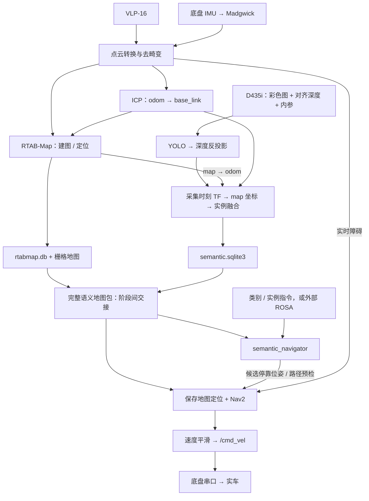

# WHEELTEC C50X 多传感器建图与语义导航

基于 **ROS 2 Humble、VLP-16、底盘 IMU 和 RealSense D435i** 的实车工作区，提供雷达建图、保存地图定位、Nav2 导航，以及按物体类别或实例编号导航的能力。自然语言入口通过独立的 ROSA 项目接入。

主流程分为两个阶段：先建立几何地图并记录物体位置，再加载同一地图上的物体数据库执行导航。**地图标签保存在 SQLite 中，几何避障由 Nav2 处理。**

本文及配套指南于 **2026-11-12** 根据本副本的源码整理；本次未启动硬件或进行实车验证。当前副本保留源码和模型，不附带已构建环境、历史地图或运行输出，首次使用需要安装依赖、编译，并准备自己的地图。

## 文档入口

- [架构与数据流](docs/语义导航数据流架构.md)：模块职责、ROS 话题、地图交接与任务协议。
- [完整启动指南](docs/启动指南.md)：环境准备、各功能启动、参数和排查方法。
- [文档索引](docs/README.md)：标定、TF、诊断和实验说明。

## 功能种类

| 类别 | 提供的功能 | 主要入口 / 实现 | 使用前提 |
|---|---|---|---|
| 传感器与底盘 | VLP-16 点云、底盘 IMU、速度反馈、电池电压、串口速度控制 | `src/car_bringup/`、`src/velodyne_bringup/` | 实际串口、雷达网络和安装 TF 正确 |
| 几何建图 | IMU 辅助点云去畸变、ICP 里程计、RTAB-Map 三维建图和二维栅格 | `rtabmap_slam.launch.py` | 雷达与 IMU 数据可用 |
| 几何定位与导航 | RTAB-Map 或 AMCL 定位，Nav2 规划、局部避障和 RViz 点选目标 | `rtabmap_slam.launch.py localization:=true`、`nav2_bringup.launch.py` | 已保存的配套地图 |
| 语义建图 | YOLO 检测、深度反投影、采集时刻 TF 变换、同类物体融合和持久化 | `semantic_mapping/one_click.launch.py` | D435i、ONNX 模型、几何建图链 |
| 物体导航 | 按类别 / 实例选择物体，生成停靠位姿、检查相机视场、预检路径并导航 | `semantic_navigation.launch.py` | 完整语义地图包，含已确认物体 |
| 自然语言交互 | 查询物体与相对位置、路径预检、创建 / 查询 / 取消导航任务 | 外部 ROSA 的 `rosa_semantic` | 另行安装 ROSA；真实模型请求需自行配置凭据 |
| 遥控与可视化 | ROS 键盘遥控、独立蓝牙遥控、安装 TF 预览 | `keyboard_teleop`、`tools/` | 与当前运行模式匹配的控制端 |
| 传感器标定 | OA-LICalib / GRIL-Calib 雷达 IMU 联合标定、IMU 单独内参标定 | `tool/`、`ImuCalibration/` | 独立标定环境及对应固件 / 接线 |
| 诊断与独立实验 | 话题与时钟检查、录包导航跟踪分析、独立 RGB-D 检测 | `tools/`、`yolov8_d435i/` | 按具体工具准备数据与依赖 |

ROS 语义主链支持 **laptop（63）、bottle（39）、cup（41）**，别名包括“笔记本、瓶子、杯子”。独立 YOLO 实验程序可使用模型中的 80 个 COCO 类别，其输出是相机坐标，不等同于语义地图坐标。

## 架构数据流



相机用于物体检测和三维位置估计，默认不参与主线雷达 RTAB-Map 几何建图。`/odom` 来自 ICP；底盘速度反馈 `/chassis_vel` 当前用于监控，没有接入轮速积分或 EKF。详细话题和控制边界见[架构文档](docs/语义导航数据流架构.md)。

## 目录结构

```text
.
├── src/
│   ├── car_bringup/          # 底盘串口、IMU 与 ROS 键盘控制
│   ├── velodyne_bringup/     # 雷达、ICP、RTAB-Map、Nav2 启动和参数
│   ├── semantic_mapping/     # RGB-D 语义建图、物体库和任务接口
│   └── car/                 # 独立串口脚本
├── scripts/                 # 常用操作脚本
├── tools/                   # 诊断、分析、蓝牙遥控、TF 预览
├── tool/                    # 联合标定系统、依赖源码与构建入口
├── ImuCalibration/          # IMU 内参标定
├── yolov8_d435i/             # 独立检测实验与模型文件
├── firmware_source_code/    # 底盘 / STM32 固件源码与工程说明
├── maps/                    # 用户自己的地图；当前仅保留目录占位
└── docs/                    # 架构、启动和专题文档
```

模型与仿真、ROSA、机械臂位于独立项目，本工作区不包含它们的完整安装环境。

## 环境准备

面向 Ubuntu 22.04、ROS 2 Humble 和系统 Python 3.10。需要已安装 ROS、rosdep 与 colcon；Velodyne、RTAB-Map、Nav2、RealSense ROS 驱动等依赖由包清单和实际驱动环境提供。

在**本仓库根目录**执行：

```bash
export LIDAR_WS="$(pwd -P)"
source /opt/ros/humble/setup.bash
rosdep install --from-paths src --ignore-src --rosdistro humble -y
colcon build --symlink-install \
  --packages-select car_bringup velodyne_bringup semantic_mapping
source "$LIDAR_WS/install/setup.bash"
```

语义建图另需 ONNX Runtime 和 RealSense Python SDK。原虚拟环境已清理，请按[启动指南中的环境准备](docs/启动指南.md#1-环境准备)创建独立环境。不要将 IMU 标定用的 NumPy 2 环境混入 Humble 的 ROS Python 环境。

## 快速启动语义建图

完成环境准备后，在仓库根目录设置环境路径，并将 `YOUR_D435I_SERIAL` 替换为实际相机序列号：

```bash
export LIDAR_WS="$(pwd -P)"
source /opt/ros/humble/setup.bash
source "$LIDAR_WS/install/setup.bash"
export LIDAR_AI_ENV="$HOME/.venvs/lidar-ai"
export LIDAR_AI_SITE="$("$LIDAR_AI_ENV/bin/python" -c 'import sysconfig; print(sysconfig.get_path("purelib"))')"

ros2 launch semantic_mapping one_click.launch.py \
  serial_no:=YOUR_D435I_SERIAL \
  imu_port:=auto \
  model_path:="$LIDAR_WS/yolov8_d435i/models/yolov8n_256.onnx" \
  python_site_packages:="$LIDAR_AI_SITE" \
  start_rviz:=true
```

该入口包含相机、雷达、只读底盘 IMU、ICP、RTAB-Map、语义建图和健康监控；底盘节点不订阅运动指令。每次创建新的 `map_id`，默认保存到 `~/.ros/semantic_mapping/runs/<map_id>/`，终端会打印实际路径。

建图运行目录还需要导出为完整语义地图包，才能用于下一个导航阶段。现有 `scripts/save_rtabmap_map.sh` 只处理几何地图，尚无统一生成完整语义地图包的保存脚本；详见[地图交接要求](docs/启动指南.md#4-语义地图包与物体导航)。

## 启动物体导航

先准备同一地图会话生成的完整 `maps/latest/`，其中需要 `rtabmap.db`、`map.yaml`、`map.pgm`、`semantic.sqlite3`、`run_identity.json` 和 `map_snapshot.json`。当前副本未附带这些文件。

```bash
ros2 launch semantic_mapping semantic_navigation.launch.py \
  maps_root:="$LIDAR_WS/maps" \
  serial_no:=YOUR_D435I_SERIAL \
  imu_port:=auto \
  enable_chassis_control:=true
```

**该命令允许实车接收导航速度。** 启动文件的 `enable_chassis_control` 默认值为 `true`；设为 `false` 会禁用本启动链的底盘速度订阅，并拒绝结构化 `start` 请求，但 Nav2 仍可能生成速度消息。

另一个已加载同一工作区环境的终端中，发送固定目标：

```bash
# 同类物体存在多个时，替换为地图中真实的实例编号
ros2 topic pub --once /semantic_nav/target std_msgs/msg/String "{data: 'bottle:1'}"
ros2 topic echo /semantic_nav/status
```

自然语言查询、预检、任务状态与取消由外部 ROSA 提供，启动方法见[完整启动指南](docs/启动指南.md#6-自然语言接口可选外部项目)。

## 其他启动方法

| 目标 | 启动方式 |
|---|---|
| 纯雷达建图、地图导出、AMCL 导航 | [几何建图与导航步骤](docs/启动指南.md#3-几何建图与定位导航) |
| 在已有建图 / 定位系统上附加语义节点 | [附加语义建图步骤](docs/启动指南.md#5-附加语义建图与独立检测) |
| ROS 键盘遥控 | `ros2 run car_bringup keyboard_teleop`，需要可控底盘节点；W/S、A/D、Q/E、空格停止 |
| 安装 TF 预览 | `/usr/bin/python3 tools/preview_lidar_camera_tf.py --whole-vehicle --rviz` |
| 蓝牙底盘工具 | [工具说明](tools/bluetooth_chassis_control.md) |
| OA / GRIL / IMU 标定 | [标定启动与环境要求](docs/启动指南.md#7-标定与辅助工具) |

## 使用边界

- 本副本中的地图、构建产物、虚拟环境、日志和嵌套 Git 元数据已清理；模型和第三方源码仍在，运行依赖需要重建。
- 源码仍有原机器的模型路径、相机序列号和串口默认值，示例通过参数覆盖；部分传统定位入口还固定读取旧目录，详见启动指南。
- 检测位置是物体可见表面附近的估计点。Nav2 报告到达不等于已经通过实时图像重新确认物体仍在那里。
- 回环后的历史语义点重投影、对象搬动后的失效处理、到达后视觉复核和统一语义地图保存入口仍待完善。
- 文档中的命令依据当前源码整理；新机器依赖安装、地图包恢复和真实行驶需在实际环境中验证。
