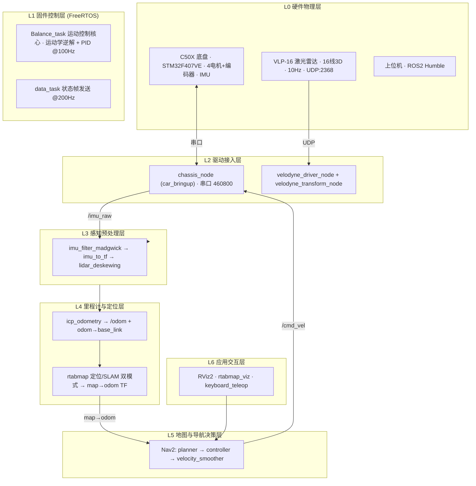

# WHEELTEC C50X + VLP-16 激光雷达 SLAM 与自主导航

基于 **ROS2 Humble** 的三维激光雷达建图与自主导航工程：WHEELTEC C50X 差速底盘（STM32F407VE 固件）+ Velodyne VLP-16 16 线雷达，使用 RTAB-Map 完成 3D LiDAR SLAM / 定位，Nav2 完成自主导航，并提供 AMCL 备选定位方案。

仓库同时收录底盘固件源码（`firmware_source_code/`，WHEELTEC 官方 STM32/FreeRTOS 工程，Keil 编译），与上位机 ROS2 代码形成"固件 + 应用"完整技术栈。

## 1. 数据流框架

### 1.1 分层架构

系统自上而下分为 7 层，固件与 ROS 之间的唯一边界是串口协议（下行 11B 控制帧，上行 24B 状态帧 @200Hz，帧头 `0x7B`、帧尾 `0x7D`、BCC 异或校验）。



### 1.2 三条数据流主线

| 主线 | 路径 | 方向 |
|---|---|---|
| 感知流 | `VLP-16 → /velodyne_packets → /velodyne_points → /velodyne_points/deskewed → {icp_odometry, rtabmap, local_costmap}` | 上行 |
| 状态流 | `底盘串口 → /imu_raw → /imu/data → base_link_stabilized TF` | 上行 |
| 控制流 | `导航目标 → Nav2 → cmd_vel_nav → velocity_smoother → /cmd_vel → chassis_node → 串口控制帧 → 电机` | 下行 |

两个闭环：固件内编码器 PID 速度环（100Hz）；ROS 内"点云→ICP→RTAB-Map→costmap→controller"位姿环。

### 1.3 关键话题与 TF

| 话题 | 类型 | 发布者 | 作用 |
|---|---|---|---|
| `/velodyne_packets` | Velodyne packet | `velodyne_driver_node` | 原始 UDP 包 |
| `/velodyne_points` | PointCloud2 | `velodyne_transform_node` | 标定后点云（`min_range=0.5`） |
| `/velodyne_points/deskewed` | PointCloud2 | `lidar_deskewing` | 运动去畸变点云 |
| `/imu_raw` | Imu | `chassis_node` | 原始 IMU（无磁力计） |
| `/imu/data` | Imu | `imu_filter_madgwick` | 滤波后姿态（gain=0.01） |
| `/odom` | Odometry | `icp_odometry` | ICP 里程计 |
| `/map` | OccupancyGrid | `rtabmap`（定位/SLAM） | 全局地图 |
| `/static_map` | OccupancyGrid | `map_server` | 静态地图（RTAB-Map 导航流程，避免与 `/map` 冲突） |
| `/cmd_vel` | Twist | `velocity_smoother` | 最终底盘速度指令 |
| `cmd_vel_nav` | Twist | `controller_server` | Nav2 内部未平滑速度 |

TF 树：`map → odom → base_link → {velodyne, imu_link, base_link_stabilized}`

## 2. 操作环境

### 2.1 软件

| 项 | 版本 |
|---|---|
| 操作系统 | Ubuntu 22.04.5 LTS（x86_64） |
| ROS 发行版 | ROS2 Humble |
| 构建工具 | `colcon` |

### 2.2 硬件

| 设备 | 说明 |
|---|---|
| WHEELTEC C50X 底盘 | STM32F407VE 主控，四轮差速，内嵌 IMU（ICM20948/MPU6050），串口 460800 baud；固件源码见 `firmware_source_code/`（FreeRTOS 任务：Balance_task 100Hz PID 速度环、data_task 200Hz 状态帧） |
| Velodyne VLP-16 | 16 线 3D 雷达，UDP 数据，默认 `192.168.1.201:2368`，600 RPM（10Hz） |
| 上位机 | 与雷达同一局域网，与底盘通过 USB 串口连接 |

### 2.3 串口设备

- 底盘串口：`/dev/wheeltec_chassis`（460800 baud），需 udev 规则映射；`chassis_node` 参数 `port=auto` 时自动检测
- 权限：用户需在 `dialout` 组，或配置 udev 规则

### 2.4 网络

雷达驱动从 `192.168.1.201:2368`（UDP）读取数据包，上位机网卡需与雷达处于同一网段（如 `192.168.1.x`）。若收不到数据，日志会出现 `Velodyne poll() timeout`。

## 3. 依赖安装

### 3.1 ROS2 Humble

```bash
# 安装 ROS2 Humble 基础环境（桌面版）
# 参考: https://docs.ros.org/en/humble/Installation/Ubuntu-Install-Debs.html
sudo apt install ros-humble-desktop python3-colcon-common-extensions
```

### 3.2 工程依赖包

```bash
sudo apt install \
  ros-humble-velodyne-driver ros-humble-velodyne-pointcloud ros-humble-velodyne-laserscan \
  ros-humble-rtabmap-odom ros-humble-rtabmap-slam ros-humble-rtabmap-util ros-humble-rtabmap-viz \
  ros-humble-imu-filter-madgwick \
  ros-humble-nav2-map-server ros-humble-nav2-controller ros-humble-nav2-planner \
  ros-humble-nav2-behaviors ros-humble-nav2-bt-navigator ros-humble-nav2-lifecycle-manager \
  ros-humble-nav2-smoother ros-humble-nav2-velocity-smoother ros-humble-nav2-waypoint-follower \
  ros-humble-nav2-amcl ros-humble-tf2-ros \
  python3-serial
```

或在已安装 ROS2 的前提下用 rosdep 自动解析（推荐）：

```bash
cd ~/arm_car/lidar
rosdep install --from-paths src -y --ignore-src
```

### 3.3 编译工程

```bash
cd ~/arm_car/lidar
source /opt/ros/humble/setup.bash
colcon build          # 已安装包可直接运行，无需构建第三方依赖
source install/setup.bash
```

> 工程含两个自研包：`car_bringup`（底盘 ROS2 驱动 + 键盘遥控）、`velodyne_bringup`（launch 与参数配置）。第三方包由 apt 提供，本工程不编译它们。

### 3.4 串口 udev 规则（可选）

```bash
# /etc/udev/rules.d/99-wheeltec.rules
KERNEL=="ttyACM*", MODE="0666", GROUP="dialout", SYMLINK+="wheeltec_chassis"
sudo udevadm control --reload-rules && sudo udevadm trigger
```

## 4. 快速开始

标准工作流三步：**建图 → 保存地图 → 定位导航**。

### 4.1 建图（RTAB-Map 3D SLAM）

```bash
source /opt/ros/humble/setup.bash
source install/setup.bash
ros2 launch velodyne_bringup rtabmap_slam.launch.py
```

启动雷达驱动、底盘、IMU 滤波、去畸变、ICP 里程计和 RTAB-Map 建图。用键盘遥控或手动推车巡游场地：

```bash
# 另开终端：键盘遥控（W/S 前进后退、A/D 转向、Q/E 调速、空格急停）
ros2 run car_bringup keyboard_teleop
```

### 4.2 保存地图

```bash
./scripts/save_rtabmap_map.sh
```

自动将当前地图保存为：

```text
maps/rtabmap_nav2_latest.yaml   # Nav2 静态地图元数据
maps/rtabmap_nav2_latest.pgm    # Nav2 静态地图图像
maps/rtabmap_nav2_latest.db     # RTAB-Map 定位数据库
```

### 4.3 定位导航（RTAB-Map 定位 + Nav2）

```bash
ros2 launch velodyne_bringup rtabmap_nav_complete.launch.py
```

启动 RTAB-Map 定位（加载 `maps/rtabmap_nav2_latest.db`，自动以 DB 中最后位姿作为初始定位）+ Nav2 导航（加载 `maps/rtabmap_nav2_latest.yaml`）。在 RViz2 中使用 **2D Pose Estimate** 修正初始位姿（若车不在建图结束位置）、**Nav2 Goal** 下发目标点。

### 4.4 备选方案：AMCL 定位导航

```bash
ros2 launch velodyne_bringup nav2_bringup.launch.py
```

使用 3D 点云投影 2D 扫描 + AMCL 粒子滤波定位（需要先在 RViz 手动给出初始位姿）。

### 4.5 运行健康检查

```bash
ros2 node list | sort                       # 确认节点齐全
ros2 topic hz /velodyne_points              # 雷达频率 ~10Hz
ros2 topic hz /velodyne_points/deskewed     # 去畸变链路
ros2 topic hz /odom                         # ICP 里程计
ros2 run tf2_ros tf2_echo map base_link     # TF 链路
```

导航成功标志（日志）：

```text
controller_server: Reached the goal!
bt_navigator: Goal succeeded
```
