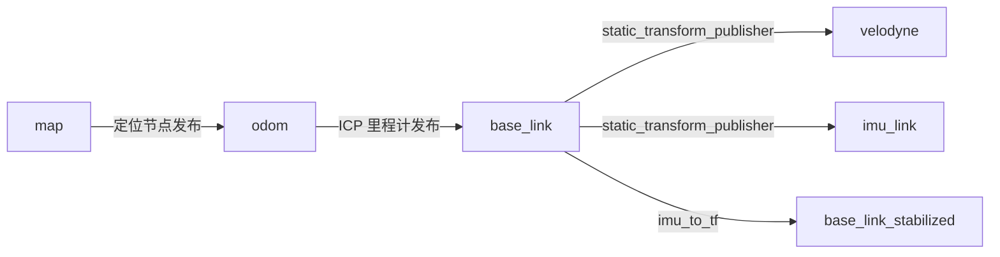
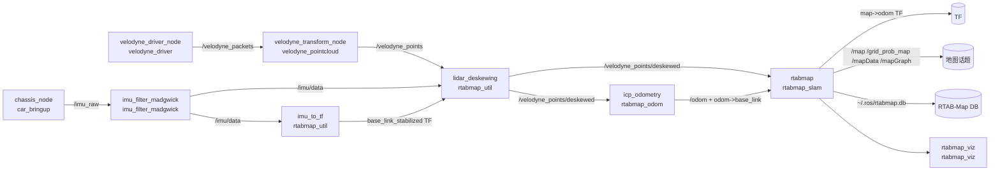
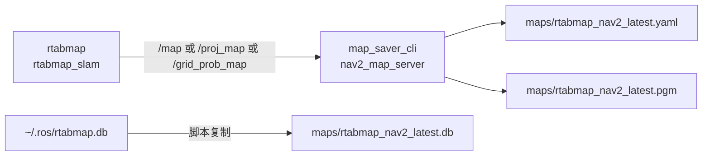
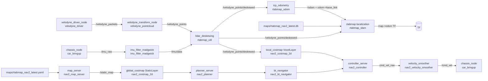
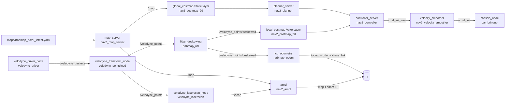
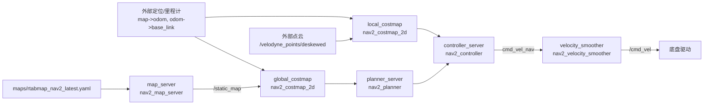

# 节点工作图与数据流

本文档总结当前工程中建图、保存地图、RTAB-Map 定位导航、AMCL 导航和 Nav2-only 导航的节点关系、数据流和功能包出处。

相关 launch：

- `src/velodyne_bringup/launch/rtabmap_slam.launch.py`
- `src/velodyne_bringup/launch/lidar3d.launch.py`
- `src/velodyne_bringup/launch/rtabmap_localization.launch.py`
- `src/velodyne_bringup/launch/rtabmap_nav_complete.launch.py`
- `src/velodyne_bringup/launch/nav2_bringup.launch.py`
- `src/velodyne_bringup/launch/nav2_navigation.launch.py`

## 坐标系总览



| TF | 发布者 | 功能包 | 作用 |
|---|---|---|---|
| `map -> odom` | AMCL 或 RTAB-Map | `nav2_amcl` 或 `rtabmap_slam` | 把机器人里程计轨迹对齐到全局地图。 |
| `odom -> base_link` | ICP odometry | `rtabmap_odom` | 发布局部连续里程计。 |
| `base_link -> velodyne` | static TF | `tf2_ros` | 雷达相对底盘安装位姿。 |
| `base_link -> imu_link` | static TF | `tf2_ros` | IMU 相对底盘安装位姿。 |
| `base_link -> base_link_stabilized` | IMU to TF | `rtabmap_util` | 为点云去畸变提供稳定姿态参考。 |

## 建图流程：RTAB-Map SLAM

启动命令：

```bash
ros2 launch velodyne_bringup rtabmap_slam.launch.py
```



### 建图节点出处

| 节点名 | executable | 功能包 | 输入 | 输出 | 作用 |
|---|---|---|---|---|---|
| `velodyne_driver_node` | `velodyne_driver_node` | `velodyne_driver` | VLP-16 UDP 数据 | `/velodyne_packets` | 读取 VLP-16 原始 packet。 |
| `velodyne_transform_node` | `velodyne_transform_node` | `velodyne_pointcloud` | `/velodyne_packets` | `/velodyne_points` | 把 packet 转成 `PointCloud2`。 |
| `static_tf_base_to_velodyne` | `static_transform_publisher` | `tf2_ros` | launch 参数 | TF | 发布 `base_link -> velodyne`。 |
| `static_tf_base_to_imu` | `static_transform_publisher` | `tf2_ros` | launch 参数 | TF | 发布 `base_link -> imu_link`。 |
| `chassis_node` | `chassis_node` | `car_bringup` | `/dev/wheeltec_chassis` 串口 | `/imu_raw`, `/battery`, `/chassis_vel` | 读取底盘状态和 IMU 原始数据。 |
| `imu_filter_madgwick` | `imu_filter_madgwick_node` | `imu_filter_madgwick` | `/imu_raw` | `/imu/data` | 输出滤波后的 IMU 姿态/角速度。 |
| `imu_to_tf` | `imu_to_tf` | `rtabmap_util` | `/imu/data` | `base_link -> base_link_stabilized` | 生成稳定帧供去畸变使用。 |
| `lidar_deskewing` | `lidar_deskewing` | `rtabmap_util` | `/velodyne_points`, TF | `/velodyne_points/deskewed` | 对一帧点云做运动去畸变。 |
| `icp_odometry` | `icp_odometry` | `rtabmap_odom` | `/velodyne_points/deskewed` | `/odom`, `odom -> base_link` | 基于点云 ICP 发布里程计。 |
| `rtabmap` | `rtabmap` | `rtabmap_slam` | `/velodyne_points/deskewed`, `/odom`, TF | `/map`, `/grid_prob_map`, `/mapData`, `map -> odom`, `~/.ros/rtabmap.db` | 建图、回环、生成 2D/3D 地图。 |
| `rtabmap_viz` | `rtabmap_viz` | `rtabmap_viz` | RTAB-Map 数据 | 可视化窗口 | 显示 RTAB-Map 建图状态。 |

## 保存地图流程

启动命令：

```bash
./scripts/save_rtabmap_map.sh
```



| 节点/脚本 | 来源 | 输入 | 输出 | 作用 |
|---|---|---|---|---|
| `save_rtabmap_map.sh` | `scripts/save_rtabmap_map.sh` | ROS 地图话题、`~/.ros/rtabmap.db` | latest YAML/PGM/DB | 自动保存最新 Nav2 地图和 RTAB-Map DB。 |
| `map_saver_cli` | `nav2_map_server` | `/map`、`/proj_map` 或 `/grid_prob_map` | `.yaml`, `.pgm` | 把 `OccupancyGrid` 保存成 Nav2 静态地图。 |

保存结果：

| 文件 | 作用 |
|---|---|
| `maps/rtabmap_nav2_latest.yaml` | Nav2 静态地图元数据。 |
| `maps/rtabmap_nav2_latest.pgm` | Nav2 静态地图图像。 |
| `maps/rtabmap_nav2_latest.db` | RTAB-Map 定位使用的数据库。 |

## RTAB-Map 定位 + Nav2 导航流程

启动命令：

```bash
ros2 launch velodyne_bringup rtabmap_nav_complete.launch.py
```

该 launch 包含：

- `rtabmap_localization.launch.py`
- `nav2_navigation.launch.py`



### RTAB-Map 定位导航节点出处

| 节点名 | executable | 功能包 | 输入 | 输出 | 作用 |
|---|---|---|---|---|---|
| `velodyne_driver_node` | `velodyne_driver_node` | `velodyne_driver` | VLP-16 UDP 数据 | `/velodyne_packets` | 读取 VLP-16 数据。 |
| `velodyne_transform_node` | `velodyne_transform_node` | `velodyne_pointcloud` | `/velodyne_packets` | `/velodyne_points` | 生成点云。 |
| `chassis_node` | `chassis_node` | `car_bringup` | 串口、`/cmd_vel` | `/imu_raw`, `/battery`, `/chassis_vel` | 读取底盘状态并发送速度命令。 |
| `imu_filter_madgwick` | `imu_filter_madgwick_node` | `imu_filter_madgwick` | `/imu_raw` | `/imu/data` | IMU 滤波。 |
| `imu_to_tf` | `imu_to_tf` | `rtabmap_util` | `/imu/data` | `base_link -> base_link_stabilized` | 生成稳定帧。 |
| `lidar_deskewing` | `lidar_deskewing` | `rtabmap_util` | `/velodyne_points`, TF | `/velodyne_points/deskewed` | 点云去畸变。 |
| `icp_odometry` | `icp_odometry` | `rtabmap_odom` | `/velodyne_points/deskewed` | `/odom`, `odom -> base_link` | 发布 ICP 里程计。 |
| `rtabmap` | `rtabmap` | `rtabmap_slam` | `/velodyne_points/deskewed`, `/odom`, `rtabmap_nav2_latest.db` | `map -> odom`, `/localization_pose` 等 | 使用最新 DB 做 RTAB-Map 定位。 |
| `map_server` | `map_server` | `nav2_map_server` | `rtabmap_nav2_latest.yaml` | `/static_map` | 发布 Nav2 静态地图；该流程中 remap 到 `/static_map`，避免和 RTAB-Map 的 `/map` 冲突。 |
| `planner_server` | `planner_server` | `nav2_planner` | global costmap、目标点 | 全局路径 | 生成全局路径。 |
| `controller_server` | `controller_server` | `nav2_controller` | 全局路径、local costmap、TF | `cmd_vel_nav` | DWB 局部控制。 |
| `velocity_smoother` | `velocity_smoother` | `nav2_velocity_smoother` | `cmd_vel_nav` | `/cmd_vel` | 平滑速度命令并发送到底盘。 |
| `bt_navigator` | `bt_navigator` | `nav2_bt_navigator` | Nav2 action goal | 行为树调度 | 调度规划、控制和恢复行为。 |
| `behavior_server` | `behavior_server` | `nav2_behaviors` | local costmap、TF | 恢复动作速度命令 | 执行旋转、后退、等待等行为。 |
| `smoother_server` | `smoother_server` | `nav2_smoother` | 全局路径 | 平滑路径 | 平滑全局路径。 |
| `waypoint_follower` | `waypoint_follower` | `nav2_waypoint_follower` | 路点任务 | 路点导航行为 | 执行多路点任务。 |
| `lifecycle_manager_navigation` | `lifecycle_manager` | `nav2_lifecycle_manager` | 生命周期节点列表 | 激活/关闭生命周期节点 | 管理 Nav2 生命周期。 |
| `rviz2_nav2` | `rviz2` | `rviz2` | ROS 话题和 TF | 图形界面 | 可视化地图、路径、costmap 和目标。 |

## AMCL + Nav2 导航流程

启动命令：

```bash
ros2 launch velodyne_bringup nav2_bringup.launch.py
```



### AMCL 导航特有节点出处

| 节点名 | executable | 功能包 | 输入 | 输出 | 作用 |
|---|---|---|---|---|---|
| `velodyne_laserscan` | `velodyne_laserscan_node` | `velodyne_laserscan` | `/velodyne_points` | `/scan` | 将 3D 点云投影成 AMCL 使用的 2D LaserScan。 |
| `amcl` | `amcl` | `nav2_amcl` | `/scan`, `/map`, `/odom`, `/initialpose` | `/amcl_pose`, `map -> odom` | 粒子滤波定位。 |
| `map_server` | `map_server` | `nav2_map_server` | `rtabmap_nav2_latest.yaml` | `/map` | 发布 AMCL 和 global costmap 使用的静态地图。 |

其它 Nav2 节点出处与 RTAB-Map 定位导航流程一致。

## Nav2-only 流程

启动命令：

```bash
ros2 launch velodyne_bringup nav2_navigation.launch.py
```

这个流程只启动 Nav2 栈，不启动传感器、ICP 或定位。要求外部已经提供：

- `map -> odom`
- `odom -> base_link`
- `/velodyne_points/deskewed`，如果 local costmap 仍要使用实时点云避障



## 关键话题汇总

| 话题 | 类型 | 发布者 | 订阅者 | 作用 |
|---|---|---|---|---|
| `/velodyne_packets` | Velodyne packet | `velodyne_driver_node` | `velodyne_transform_node` | VLP-16 原始包。 |
| `/velodyne_points` | `sensor_msgs/PointCloud2` | `velodyne_transform_node` | `lidar_deskewing`, `velodyne_laserscan` | 原始点云。 |
| `/velodyne_points/deskewed` | `sensor_msgs/PointCloud2` | `lidar_deskewing` | `icp_odometry`, `rtabmap`, local costmap | 去畸变点云。 |
| `/scan` | `sensor_msgs/LaserScan` | `velodyne_laserscan` | `amcl` | AMCL 的 2D 激光输入。 |
| `/imu_raw` | `sensor_msgs/Imu` | `chassis_node` | `imu_filter_madgwick` | 原始 IMU。 |
| `/imu/data` | `sensor_msgs/Imu` | `imu_filter_madgwick` | `imu_to_tf`, `lidar_deskewing` | 滤波后 IMU。 |
| `/odom` | `nav_msgs/Odometry` | `icp_odometry` | Nav2、AMCL、RTAB-Map | 局部里程计。 |
| `/map` | `nav_msgs/OccupancyGrid` | AMCL 模式 `map_server` 或 RTAB-Map | AMCL/global costmap/保存脚本 | 全局地图。 |
| `/static_map` | `nav_msgs/OccupancyGrid` | RTAB-Map 定位 Nav2-only 中的 `map_server` | global costmap | 避免与 RTAB-Map `/map` 冲突的静态地图。 |
| `/grid_prob_map` | `nav_msgs/OccupancyGrid` | `rtabmap` | 保存脚本可选 | RTAB-Map 概率栅格地图。 |
| `/initialpose` | `geometry_msgs/PoseWithCovarianceStamped` | RViz/脚本 | `amcl` | AMCL 初始位姿。 |
| `/cmd_vel` | `geometry_msgs/Twist` | `velocity_smoother` | `chassis_node` | 最终底盘速度命令。 |
| `cmd_vel_nav` | `geometry_msgs/Twist` | `controller_server`, `behavior_server` | `velocity_smoother` | Nav2 内部未平滑速度命令。 |

## 节点包出处总表

| 功能 | 节点/executable | 功能包 |
|---|---|---|
| VLP-16 packet 驱动 | `velodyne_driver_node` | `velodyne_driver` |
| VLP-16 点云转换 | `velodyne_transform_node` | `velodyne_pointcloud` |
| 点云转 2D scan | `velodyne_laserscan_node` | `velodyne_laserscan` |
| 静态 TF | `static_transform_publisher` | `tf2_ros` |
| 底盘串口驱动 | `chassis_node` | `car_bringup` |
| IMU 滤波 | `imu_filter_madgwick_node` | `imu_filter_madgwick` |
| IMU 生成稳定帧 | `imu_to_tf` | `rtabmap_util` |
| 点云去畸变 | `lidar_deskewing` | `rtabmap_util` |
| ICP 里程计 | `icp_odometry` | `rtabmap_odom` |
| RTAB-Map SLAM/定位 | `rtabmap` | `rtabmap_slam` |
| RTAB-Map 可视化 | `rtabmap_viz` | `rtabmap_viz` |
| AMCL 定位 | `amcl` | `nav2_amcl` |
| 地图服务器/保存 | `map_server`, `map_saver_cli` | `nav2_map_server` |
| Nav2 控制器 | `controller_server` | `nav2_controller` |
| Nav2 全局规划器 | `planner_server` | `nav2_planner` |
| Nav2 路径平滑 | `smoother_server` | `nav2_smoother` |
| Nav2 行为恢复 | `behavior_server` | `nav2_behaviors` |
| Nav2 行为树导航 | `bt_navigator` | `nav2_bt_navigator` |
| Nav2 路点跟随 | `waypoint_follower` | `nav2_waypoint_follower` |
| Nav2 速度平滑 | `velocity_smoother` | `nav2_velocity_smoother` |
| Nav2 生命周期管理 | `lifecycle_manager` | `nav2_lifecycle_manager` |
| RViz 可视化 | `rviz2` | `rviz2` |
