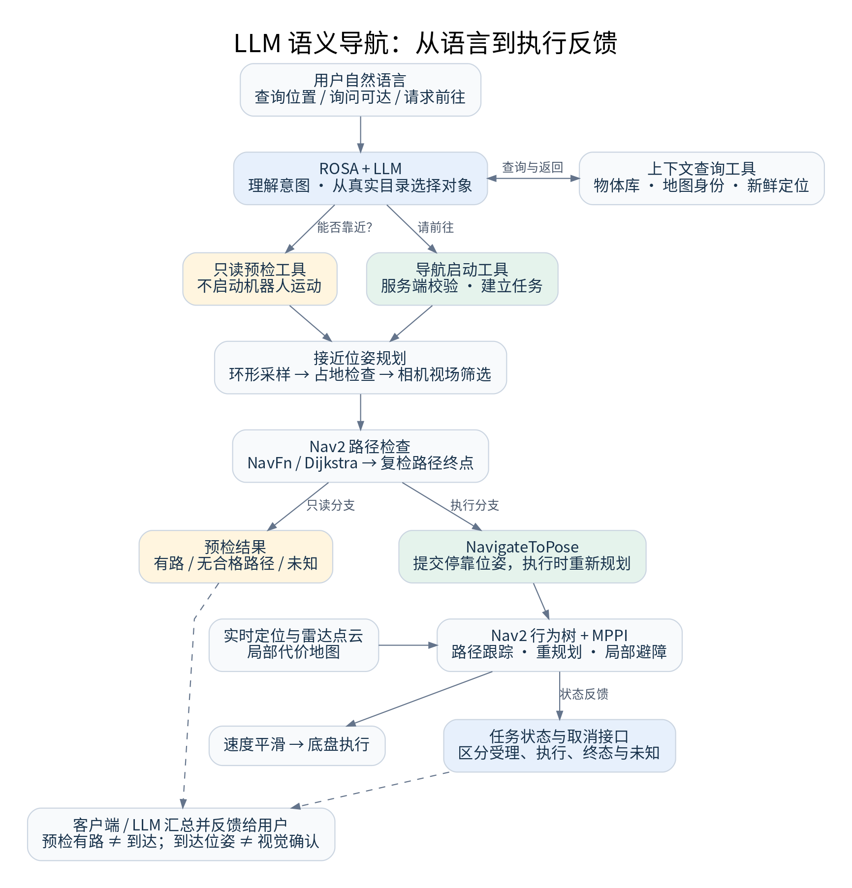

# 一句“去最近的瓶子旁边”，机器人如何执行？理解 LLM 语义导航架构

“前进一米”和“去最近的瓶子旁边”，需要机器人处理不同层次的问题。

后一句话包含对象识别、相对位置判断、停靠位姿选择、路径规划和执行反馈。语言模型可以理解这句话，但它需要借助机器人系统的真实数据和工具，才能把表达落到具体行动上。

本文介绍一种基于 ROSA、LLM、物体级语义地图和 Nav2 的分层架构，重点讲清自然语言如何逐步转换为导航任务，以及各层应该承担什么职责。

## 一、总体架构：从语言理解到运动执行

可以把系统分为四个层次：

- **语言交互层**理解用户意图，选择查询、预检或行动。
- **语义任务层**读取真实对象目录，确定实例，管理任务身份和状态。
- **几何规划层**计算机器人接近物体的停车位置与朝向，并检查路径。
- **运动执行层**完成路径跟踪、局部避障、速度平滑和底盘控制。

图中预检与执行共享接近规划能力，但只有执行分支提交运动导航目标。虚线表示预检结果和任务状态向用户反馈的方向。

这种分工使每一步都有明确依据：模型选对象，几何模块求位姿，导航系统执行运动，任务状态决定最终能够向用户报告什么。

## 二、让“那个瓶子”对应到真实对象

把语言中的对象对应到机器人数据中的实体，称为**语义落地，Grounding**。

语言模型知道“瓶子”是什么意思，却不知道当前地图中的瓶子有哪些编号、分别在哪里。系统需要通过工具返回真实对象目录，包括类别、实例编号、保存位置和观测时间。

选择目标前，还需要读取当前地图身份和机器人定位。对象坐标属于地图坐标系，而“最近”“左边”“前面”等描述依赖机器人当前姿态。

因此，相对距离与方位应由机器人侧依据新鲜定位计算，再作为结构化信息交给模型。定位缺失或过期时，模型不应继续猜测空间关系。

这里还要区分两种距离：

**几何距离**描述对象与机器人在空间中有多近；**路径距离**描述绕开障碍实际需要走多远。隔墙的瓶子可能直线最近，但路径很长，甚至在当前约束下无法到达。

如果物体库只保存类别和坐标，就没有依据回答颜色或房间归属。“去厨房里的红色杯子旁边”需要相应属性数据，不能靠模型常识补齐。

## 三、工具调用：让自然语言选择明确操作

**Tool Calling，工具调用**，允许模型在理解用户请求后，选择结构化操作，并根据真实返回结果继续推理或回答。

一套语义导航工具可以划分为五类：

| 工具能力 | 输入或依据 | 输出 |
|---|---|---|
| 查询上下文 | 当前地图与机器人系统 | 对象目录、相对关系、可用状态 |
| 只读接近预检 | 指定物体实例 | 候选停车点、路径检查结果 |
| 启动物体导航 | 指定物体实例 | 任务受理结果与任务身份 |
| 查询任务状态 | 当前客户端任务 | 规划、执行及终态 |
| 请求取消 | 当前客户端任务 | 取消请求结果，随后需确认终态 |

例如，“瓶子在哪里”只需查询；“能靠近它吗”可以预检；“去它旁边”才表达行动意图。

这种差异应同时体现在工具描述和交互提示中。服务端还需要检查控制权限、目标是否存在、系统是否忙碌等条件。提示词有助于约束模型行为，确定性校验则负责处理实际请求，两者不能相互替代。

工具返回也应采用结构化结果。一次调用成功，可能只表示查到了目录或创建了任务，并不代表机器人已经到达。

## 四、为什么要规划“接近位姿”

物体位置与机器人终点是两个不同概念。

瓶子可能位于桌面，坐标高于地面；它所在的水平位置也可能被桌子占据。将该坐标直接作为底盘目标，不符合运动约束。

机器人需要的是一个**接近位姿**：在地面上的停车位置，加上合适的朝向。这个位姿既要容纳车体，也要让相机按几何预测能够观察目标。

### 1. 环形采样：生成可尝试的位置

一种容易实现和解释的方法是在目标周围选择多个半径，沿圆周采样位置，再枚举车体偏航角。

距离过近可能有碰撞风险，也可能使目标超出相机视场；距离过远则可能不满足接近任务。因此需要设定合理范围。

这是一种离散搜索。采样越密计算量越大，采样越稀则越可能漏掉狭窄可行区域。

### 2. 占地检查：车身必须放得下

停车检查不能只看机器人中心点。还应使用车体轮廓，或一个保守的包络形状，检查其覆盖区域是否存在障碍、未知格或地图边界。

占地筛选回答的是“这个位置能否停”，尚未回答“机器人能否从当前位置开过去”。后一个问题需要路径规划。

### 3. 相机投影：停车后是否朝向目标

对每个候选位姿，将物体地图坐标变换到该位姿下的相机坐标，再利用相机内参投影到图像平面。

目标应位于相机前方，且落在图像边界内的安全区域。候选还可以按投影距离图像中心的偏差排序，并保留多个接近方向，避免所有候选集中在同一侧。

这一步需要使用真实安装外参。相机可能具有俯仰、偏航和位置偏置，不能简单认为车头对准物体就等于相机对准物体。

单点投影具有明确边界：它只预测代表点是否进入视场，不能保证整个物体可见，也不包含遮挡判断。若需要判断桌沿、墙面是否挡住物体，还需要额外的射线或场景几何检查。

## 五、路径预检：几何可停不等于路径可达

候选停车点通过占地与视场筛选后，可以交给 Nav2 的 ComputePathToPose 检查路径。

例如，全局规划可采用 **NavFn**，配置为基于 Dijkstra 的搜索方式，在代价地图中寻找通向目标的路线。其他规划器也可以承担这一职责，具体选择取决于机器人运动模型和场景。

规划器可能允许终点容差，所以返回路径后，还应检查实际终点是否满足占地和视场约束，不能只验证最初请求的候选。

预检结果最好区分三种情况：

- **找到路径**：当时条件下得到合格路径。
- **没有合格路径**：在已检查的候选与约束下未找到可用结果。
- **无法判断**：定位、地图或规划服务缺失，或者结果超时、未确认。

有限候选搜索没有找到路径，不等于证明所有连续空间位置都不可达。服务超时也不能直接解释为障碍堵塞。

真正执行导航时，应根据当时环境重新规划。预检路径是一次规划结果，不是对未来行驶条件的保证。

## 六、Nav2 与 MPPI：将路线转为连续运动

全局规划负责总体路线，局部控制负责眼前一段运动。

**MPPI，模型预测路径积分控制**，是一种基于采样的模型预测控制方法。它从候选控制序列出发，通过运动模型预测未来轨迹，再依据障碍、路径、目标、朝向和运动限制等代价更新控制序列。

控制器只执行当前一步，下一周期根据新状态重新计算。这种滚动时域方式允许机器人持续响应定位变化和近处障碍。

MPPI 的表现取决于运动模型、采样规模、预测时域、代价权重、机器人轮廓和速度约束。增大采样数量并不自动意味着效果更好，还要考虑实时计算能力。

导航中的环境信息也分层组织：静态地图提供全局结构，局部代价地图利用实时雷达点云更新近处障碍，膨胀层则在障碍周围形成代价缓冲区域。

Nav2 行为树协调规划、路径跟踪、重规划与恢复。控制结果经过速度平滑，再由底盘接口转为硬件命令。LLM 工作在任务层，不进入这种高频运动控制回路。

## 七、任务身份与状态：可靠反馈的基础

自然语言系统尤其需要区分“请求已受理”和“目标已完成”。

任务可以经历规划中、导航中、取消中，最终进入成功、失败或取消；如果结果过期或通信状态无法确认，还应允许报告未知。

可靠接口通常需要几类身份信息：

| 身份 | 解决的问题 |
|---|---|
| 地图身份 | 避免对错误地图上的对象执行任务 |
| 服务会话身份 | 区分服务重启前后的状态 |
| 客户端与任务编号 | 确定任务归属和执行对象 |
| 请求编号 | 关联请求与响应，识别重复请求 |

配合重复请求处理，可以避免网络重试造成重复动作。状态序号和时间信息有助于识别乱序或过期反馈。

取消也需要终态确认。发送取消请求只代表提出停止要求，不能立即说机器人已经停止。系统可以提供直接取消入口，减少等待一轮模型推理带来的延迟。

这些任务机制与 LLM 的表达能力无关，却直接决定自然语言控制是否具有可追踪的执行闭环。

## 八、用一句指令串起完整流程

用户说：“去离我最近的瓶子旁边。”

1. 查询完整对象目录与当前定位，计算瓶子的相对距离。
2. 模型根据真实数据选择具体实例；必要信息不足时澄清。
3. 明确行动意图后提交接近任务；也可以先预检，但预检本身不会启动运动。
4. 服务端校验目标和任务条件，生成并筛选接近位姿。
5. Nav2 检查路径并执行导航，局部控制器持续处理路径跟踪与障碍。
6. 客户端获取对应任务终态，再向用户报告结果。

如果用户只是询问位置，流程结束于查询回答；如果只问能否靠近，流程结束于预检结果。同一个对象目录可以支持不同操作，是否执行由用户意图和服务端条件共同决定。

## 九、到达之后，还需要视觉确认吗

需要先定义任务的完成标准。

Nav2 成功通常表示机器人到达设定容差内的目标位姿。它没有自动证明物体仍在原位，也没有证明相机已经清楚看到物体。

如果任务目标是“到记忆位置附近”，导航终态可以作为主要依据；如果目标是“找到这个物体”，还需要到达后的视觉复核。

一个更完整的后续流程是：重新采集图像和深度，运行检测，结合类别与空间位置关联目标，再评估可见性和画面偏差。若需要调整，应设置明确的距离、角度和次数边界。

视觉复核属于需要额外接入的能力，不能只凭停靠点投影便认为已经实现。物体会移动，因此还需要观测时效与记忆更新机制。

LLM 语义导航的核心，是让语言选择有数据依据，让几何规划具有明确约束，让运动执行独立闭环，并让最终回答与真实任务状态一致。
