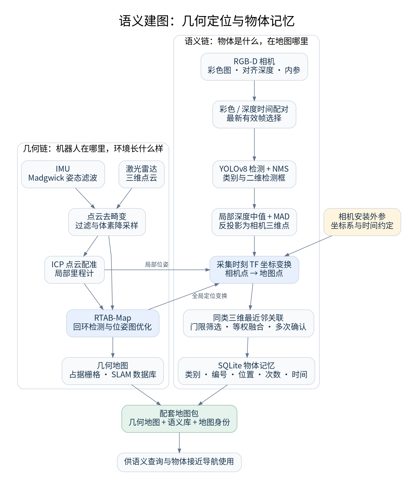

# 让机器人记住“物体在哪里”：一文理解语义建图的数据流与核心原理

机器人已经能画出房间地图，为什么还不能回答“水瓶在哪里”？

因为用于导航的占据栅格主要描述哪里有障碍、哪里可以通行。要理解“瓶子”“杯子”这样的对象，机器人还需要把视觉识别结果与空间位置联系起来，并将多次观测整理成可查询的物体记忆。

本文介绍一种基于 ROS 2 的物体级语义建图架构：激光雷达负责几何地图与定位，RGB-D 相机负责物体识别与测距，数据库负责保存物体身份和位置。重点是各模块之间的数据如何流动，以及每一步解决什么问题。

## 一、语义地图包含什么

可以把地图分为两个相互关联的层次。

**几何层描述空间结构。** 它记录墙面、障碍、空闲区域，以及机器人在环境中的位置，是路径规划和运动控制的基础。

**语义层描述物体信息。** 它记录物体类别、实例编号、三维位置、观测次数和观测时间，使系统能够查询“有哪些瓶子”“某个杯子在哪里”。

两层不必存放在同一数据结构中。几何地图可以采用占据栅格与 SLAM 数据库，语义层可以采用 SQLite 物体库，只要通过统一地图坐标系和地图身份关联起来。

本文采用的是**稀疏物体级语义地图**：每个对象主要用类别和一个三维代表点描述。它适用于物体检索和接近导航，与逐像素语义分割、稠密语义点云和完整物体三维重建具有不同的数据粒度。

## 二、总体架构：两条数据链，共享一套空间关系

图中左侧是几何链，右侧是语义链。几何链输出机器人位姿与环境地图；语义链输出带有身份的物体位置。连接两者的核心是采集时刻的坐标变换。

理解这张图可以抓住三个问题：

- **识别到了什么？** 由物体检测模型回答。
- **它相对相机在哪里？** 由深度和相机模型回答。
- **它在地图哪里？** 由机器人定位与传感器外参回答。

最后一个问题经常决定地图是否可信。即使检测框准确，时间或外参错误也会让物体落到错误的位置。

## 三、几何链：为物体定位提供空间底座

### 1. 点云去畸变：处理扫描期间的运动

旋转式激光雷达的一帧扫描并不是瞬间完成的。如果机器人在扫描期间移动，各点实际上对应不同的传感器位姿。直接把它们当成同一时刻的点，可能使墙面弯曲、边缘错位。

点云去畸变利用扫描时间与运动估计，将不同时刻的点补偿到统一参考时刻。IMU 提供快速姿态变化信息，有助于处理旋转运动。

一种可选的姿态处理方式是 **Madgwick 滤波**：融合陀螺仪和加速度计信息估计姿态。它能提供姿态参考，但不能单独提供稳定的全局位置；没有绝对航向观测时，也不能认为航向误差会被完全消除。

点云还可以经过距离过滤和**体素降采样**。体素降采样用空间网格减少重复点，降低配准计算量，同时尽量保留结构。

### 2. ICP：根据点云估计相对运动

**ICP，迭代最近点算法**，反复寻找两组点云之间的对应关系，并估计让它们更一致的刚体变换。

把新扫描与参考点云对齐后，就能得到相对移动与旋转。连续积累这些变换，形成局部里程计。

ICP 依赖几何结构和合理初值。在重复走廊、特征不足或运动过快时，配准可能退化。即使每次估计只有小误差，长时间累计也会产生漂移。

### 3. RTAB-Map：维护全局地图一致性

RTAB-Map 可以组织地图节点和约束，通过回环检测与位姿图优化改善全局一致性。机器人再次经过旧区域时，新的约束有机会修正累计误差。

三维点云还可按高度等规则转换为二维占据栅格，区分地面、障碍和未知空间，供导航使用。

地图分辨率表示单元大小，并不直接代表定位精度。物体定位还会受到深度、外参、时间同步和机器人位姿误差的共同影响。

## 四、语义链：从检测框得到相机坐标中的三维点

### 1. 彩色与深度必须对应

RGB-D 相机提供彩色图、深度图和相机内参。彩色图用于识别，深度图用于测距，内参描述像素与成像方向的关系。

首先需要把深度对齐到彩色图，使彩色像素能找到对应方向上的深度；其次需要进行时间配对，避免用较早的深度解释较新的图像。

**空间对齐和时间同步是两个独立问题。** 前者解决“是否是同一条成像射线”，后者解决“是否来自足够接近的时刻”。

当检测速度低于相机帧率时，可以缓存图像对，优先处理最新且变换可用的有效帧，并丢弃过期数据。这样能避免长队列把实时感知变成历史回放。

### 2. YOLOv8 与 NMS：确定类别和二维区域

YOLOv8 检测模型输出物体类别、置信度和检测框。输入通常先等比例缩放与补边，输出框再映射回原图。

**NMS，非极大值抑制**，用于压制同类别中高度重叠的重复候选。置信度阈值用于过滤低分结果。

检测分数与三维测量质量需要分别理解。一个类别分数较高的瓶子，也可能因为透明或反光而没有可靠深度。

### 3. 中值与 MAD：从局部深度中抑制异常值

直接读取检测框中心的单个深度值比较脆弱。中心像素可能恰好缺失，也可能落在边缘或背景上。

一种轻量方案是在框中心附近取小窗口，过滤无效、过近和过远深度，再使用**中值**与 **MAD，中位数绝对偏差**抑制离群值。有效样本不足时，拒绝生成地图观测。

这种处理可以缓解孤立噪声，却不能保证处理好透明物体或背景占优的窗口。更复杂的方案可以结合实例分割、点云聚类等方法，但需要额外的模型与计算。

### 4. 反投影：把像素方向与深度结合

**针孔相机模型反投影**利用焦距、主点和深度，把二维像素转换为相机光学坐标中的三维点。对于存在畸变的图像，还需要结合对应畸变模型处理。

相机光学坐标通常约定为向右、向下、向前；机器人车体坐标常约定为向前、向左、向上。两者之间必须通过明确的坐标变换连接。

检测框中心附近的深度通常对应物体的可见表面。因此，这个三维点应理解为**物体代表点**，不能直接当成精确的实体几何中心。

## 五、坐标变换：必须使用拍照时的位置

相机输出的是“物体相对相机的位置”。要写进地图，需要结合相机安装外参和机器人定位，将观测沿坐标链变换到地图坐标系。

这里最重要的是时间。

假设图像采集后机器人继续向前行驶，检测结果稍后才产生。如果使用检测结束时的位姿，就会把这段运动错误地加到物体位置中。

因此应按**图像采集时间**查询 TF。变换暂时不可用时，可以等待或丢弃观测；不应直接用最新位姿替代而不说明。

还应区分局部连续运动与全局修正：里程计描述短期运动，SLAM 的全局优化可能调整地图与里程计之间的关系。两者共同影响最终的物体地图坐标。

## 六、物体关联与融合：多次观测如何形成一个实例

检测器每次输出的只是一次观测。要让多帧中的同一个瓶子对应同一编号，需要进行**数据关联**。

一种简单方案是**同类别三维最近邻关联**：先筛选相同类别，再比较地图坐标距离；只有距离小于门限才关联，否则创建新实例。

关联成功后，可按观测次数做累计等权平均，并设置多次确认门槛，降低单次误检进入正式目标库的概率。同一观测还需要去重，避免重复处理抬高确认计数。

这一方案计算轻、容易解释，但也有局限：

- 门限太大，容易合并相邻同类物体；太小，则容易把一个物体拆成多个实例。
- 等权平均能缓解随机抖动，无法消除外参错误造成的系统偏差。
- 仅靠空间距离无法可靠区分外观相似、位置接近或发生移动的对象。

因此，基础版本应明确其静态物体假设。后续可按需求引入外观特征、质量加权、运动状态和过期机制，而不应把简单最近邻融合描述成完整的多目标跟踪。

## 七、语义记忆为什么要保存两种记录

数据库中可以分开保存原始成功观测和融合物体。

| 信息层次 | 保存内容 | 主要作用 |
|---|---|---|
| 地图身份 | 地图编号、坐标约定、版本信息 | 避免不同地图的数据混用 |
| 观测记录 | 时间、类别、位置、检测区域、深度质量 | 追溯物体位置的来源 |
| 物体记录 | 实例编号、融合位置、观测次数、首次与末次时间 | 支持快速检索与导航 |

物体编号通常只在所属数据库中有效，跨地图引用时需要同时携带地图身份。

建图与导航分阶段运行时，应整体交接几何地图、语义库和身份信息。单独保存一张栅格图，不能恢复物体记忆；单独复制物体库，也不能证明它与几何地图坐标一致。

## 八、回环与物体移动，是两种不同的一致性问题

**回环优化改变的是位姿估计。** 历史物体点若只保存最终地图坐标，就未必能随位姿图一起修正。完整的重投影方案通常需要保留观测与关键帧或局部坐标的关系，再随优化结果重新计算。

**物体移动改变的是环境本身。** 即使机器人定位完全正确，昨天见过的瓶子也可能已经离开原处。观测时间、重访确认和过期状态因此很重要。

两者不能仅靠多次平均解决。前者需要几何一致性维护，后者需要物体记忆更新。

从系统设计角度看，语义建图的关键是让类别识别、空间测量、时间对齐、实例关联和持久化使用同一套空间依据。这样，地图中的每个对象才能成为后续查询与语义导航的有效目标。
