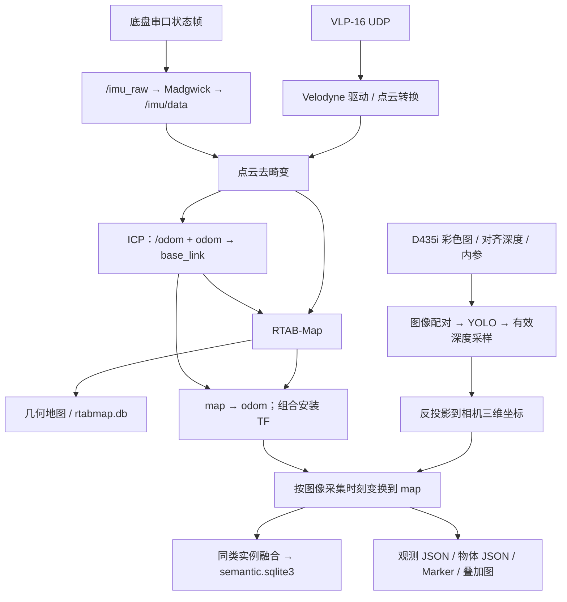
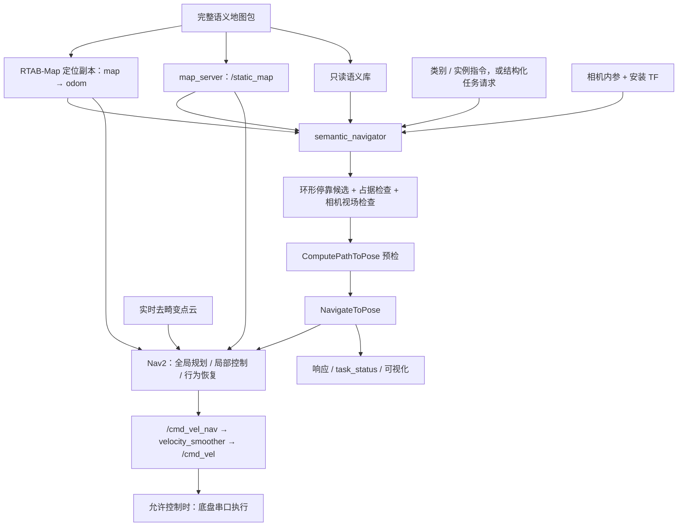
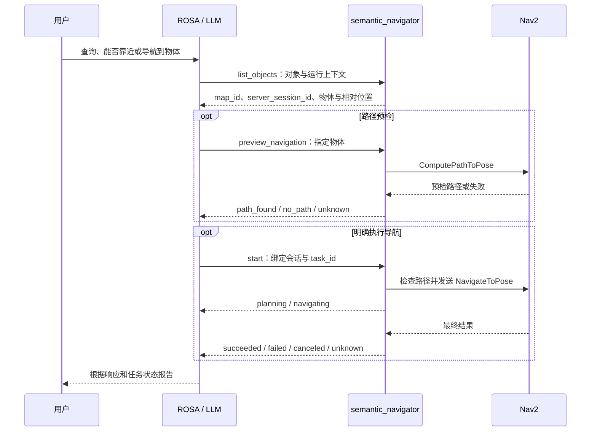

# 架构与数据流

源码核对日期：**2026-11-12**。本文描述上传副本中的实现，不依据已清理的日志或地图推断运行状态。本次仅核对源码与文档，未启动 ROS 节点或硬件。

## 1. 系统边界与模块

主系统是 **雷达几何建图 + RGB-D 物体定位 + SQLite 物体记忆 + Nav2 物体接近**。建图、保存地图、导航是不同阶段，导航依赖保存时配套的地图坐标和身份。

| 模块 | 输入 | 责任与输出 | 源码入口 |
|---|---|---|---|
| 底盘驱动 | 串口状态帧、可选 `/cmd_vel` | IMU、速度、电压；允许控制时发送串口速度帧 | [chassis_node.py](../src/car_bringup/car_bringup/chassis_node.py) |
| 几何链 | VLP-16 点云、滤波 IMU | 去畸变、ICP、RTAB-Map、TF、几何地图 | [lidar3d.launch.py](../src/velodyne_bringup/launch/lidar3d.launch.py) |
| 视觉观测 | 彩色图、对齐深度、CameraInfo、TF | YOLO 检测、深度估计、三维观测和可视化 | [node.py](../src/semantic_mapping/semantic_mapping/node.py) |
| 实例与物体库 | 已映射观测 | 同类关联、计数确认、位置融合与 SQLite 持久化 | [core.py](../src/semantic_mapping/semantic_mapping/core.py) |
| 地图加载 | 完整地图包 | 校验身份、复制数据库、生成本次导航参数 | [semantic_navigation.launch.py](../src/semantic_mapping/launch/semantic_navigation.launch.py) |
| 语义导航 | 目标实例、地图、定位、相机内参 | 停靠候选、视场检查、路径预检、任务执行与取消 | [semantic_navigation.py](../src/semantic_mapping/semantic_mapping/semantic_navigation.py) |
| 任务协议 | JSON 请求 | 对象目录、预检、开始、状态、取消及会话绑定 | [semantic_task_protocol.py](../src/semantic_mapping/semantic_mapping/semantic_task_protocol.py) |
| Nav2 | 保存栅格、实时点云、TF、目标位姿 | 全局规划、局部控制、避障与速度平滑 | [nav2_navigation.launch.py](../src/velodyne_bringup/launch/nav2_navigation.launch.py) |
| ROSA（外部） | 自然语言、任务响应 | 调用五个语义工具；不直接替代 Nav2 或底盘驱动 | 独立项目中的 `rosa_semantic` |

## 2. 建图阶段



### 几何链

```text
/velodyne_packets
  → /velodyne_points
  → /velodyne_points/deskewed
      ├→ icp_odometry → /odom 与 odom→base_link
      └→ RTAB-Map → map→odom、几何地图、rtabmap.db

底盘状态帧 → /imu_raw → Madgwick → /imu/data
                           └→ 稳定姿态参考 / 去畸变 / ICP
```

默认主线不将相机 RGB-D 输入送进 RTAB-Map。`/chassis_vel` 是反馈与监控信息，目前没有轮速积分 / EKF 接入；`/odom` 来自 ICP。

`one_click` 默认启用底盘 IMU、点云去畸变和独立运行目录；`use_chassis_imu:=false` 时同时关闭去畸变并清空 IMU 输入。它的底盘节点为只读，不订阅 `/cmd_vel`，因此单独启动键盘节点不会让这条只读链执行速度。

### 从像素到物体位置

1. 彩色图和对齐深度进行近似时间配对，默认容许差值 20 ms；CameraInfo 单独缓存。
2. 定时从队列选择采集时刻 TF 已就绪的最新帧，默认推理 2 Hz、最大帧龄 2 s。
3. ONNX Runtime CPU 运行 YOLO，默认保留 laptop / bottle / cup；置信度 0.35、NMS IoU 0.45。
4. 在检测框中心附近的 5×5 窗口采样有效深度，默认范围 0.15–6 m，至少 5 个有效样本且有效率不低于 40%。
5. 根据 CameraInfo 反投影，并查询图像采集时刻的 `map ← camera_color_optical_frame` 变换。
6. 同类别、相距不超过默认 0.35 m 的观测关联为实例，等权平均位置；默认达到 3 次观测后确认为物体。

忽略畸变时，反投影可写成：

```text
Z = depth_m
X = (u - cx) * Z / fx
Y = (v - cy) * Z / fy
p_map(t) = T_map←camera(t) * [X, Y, Z, 1]
```

位置表示可见表面附近的采样点，不包含真实物体尺寸、实体中心或完整姿态。查不到采集时刻 TF 时不退回最新 TF 写库。

源码对 `map←odom` 的锚点变化设有暂停写入条件：默认平移超过 0.75 m 或旋转超过 25°。这只是防止继续写入失配观测，不是回环后的历史语义点重投影。CameraInfo 目前未参与三路时间同步，也没有与图像做完整的缓存时效校验。

### SQLite 数据层

| 表 | 内容 | 作用 |
|---|---|---|
| `metadata` | `map_id`、地图版本、类别与 manifest | 校验语义库属于当前地图 |
| `observations` | 时间、类别、置信度、map 坐标、bbox / 深度等 payload | 保留成功写入的观测，以时间 / frame / 检测序号去重 |
| `objects` | 实例编号、类别、融合 xyz、观测数、首次 / 末次观测时间 | 提供已确认物体查询 |

物体编号在单个数据库内有效，跨地图应使用 `(map_id, object_id)`。融合由语义建图进程内的 `SemanticMapStore` 直接执行；没有另一个独立融合节点。

## 3. 地图交接与导航阶段

建图默认输出 `~/.ros/semantic_mapping/runs/<map_id>/`。导航入口则读取 `<maps_root>/latest/` 中的完整地图包：

```text
latest/
├── rtabmap.db            # RTAB-Map 几何定位库
├── map.yaml             # image 必须引用 map.pgm
├── map.pgm              # 静态占据栅格
├── semantic.sqlite3     # 同一 map_id 的物体库
├── run_identity.json    # 建图会话身份
└── map_snapshot.json    # map 坐标系、map_id 与已确认物体快照
```

加载时检查必要文件、身份与快照中的 `map_id`、`map` frame、非空物体快照和语义库元数据。导航使用本次运行目录中的 RTAB-Map 数据库副本和只读语义库副本，记录源 RTAB-Map 数据库 SHA-256，并生成本次 Nav2 参数。

当前没有统一导出上述完整地图包的保存入口。`scripts/save_rtabmap_map.sh` 只导出几何栅格并尝试备份默认数据库；它不打包 one_click 的物体库与身份。当前副本也不附带历史地图，因此需要从自己的有效会话或完整备份准备地图包。



RTAB-Map 的导航期栅格发布到 `/rtabmap_map`；地图服务器的 `/static_map` 是语义候选检查和全局代价地图的静态地图来源。全局代价地图使用静态层与膨胀层，局部代价地图使用实时点云体素层与膨胀层。

候选停靠位姿在物体周围采样，默认距离范围 0.9–2.5 m，同时检查足迹空间与目标在相机视场中的位置。调用 `ComputePathToPose` 后，再通过 `NavigateToPose` 执行接近。预检不代表实车已到达，实际开始时仍会重新规划。

语义启动链使用运行期生成的 MPPI 控制配置，普通几何导航沿用基础 Nav2 参数。不要将二者的控制器或速度参数混为同一组默认值。

## 4. 自然语言与任务协议

自然语言工具已接通，实现在独立 ROSA 项目中；本仓库提供服务端协议和 Nav2 适配。



| ROSA 工具 | 协议操作 | 作用 |
|---|---|---|
| `semantic_map_context` | `list_objects` | 查询完整物体目录、地图 / 会话、定位与依赖状态 |
| `semantic_preview_approach` | `preview_navigation` | 只规划路径，不发送导航执行目标 |
| `semantic_navigate_to_object` | `start` | 启动指定类别和实例的接近任务 |
| `semantic_task_status` | `status` | 查询本客户端任务 |
| `semantic_cancel_task` | `cancel` | 请求取消并等待 Nav2 确认 |

请求采用版本化 JSON（`schema_version=1`），通过 `std_msgs/msg/String` 话题传输。任务绑定 `client_id`、`task_id`、`map_id` 与服务端 `server_session_id`，避免重启或换地图后继续使用旧任务身份。

结构化 `start` 受服务端 `enable_chassis_control` 参数控制：节点自身默认 `false`，现有导航 launch 默认传入 `true`。ROSA 的兼容参数 `--enable-navigation` 不再构成第二个权限开关。

任务状态包括 `planning`、`navigating`、`canceling`、`canceled`、`succeeded`、`failed`、`rejected`、`unknown`。`succeeded` 且原因为 `nav2_succeeded` 表示 Nav2 报告到达；还没有到达后的真实图像复核。查询中展示的相对位置依赖新鲜定位 TF；数据库记录时间不能证明物体仍在原处。

## 5. 主要 ROS 接口

| 接口 | 类型 | 用途 |
|---|---|---|
| `/velodyne_points`、`/velodyne_points/deskewed` | `sensor_msgs/msg/PointCloud2` | 原始点云、去畸变点云 |
| `/imu_raw`、`/imu/data` | `sensor_msgs/msg/Imu` | 底盘 IMU、滤波 IMU |
| `/odom` | `nav_msgs/msg/Odometry` | ICP 里程计 |
| `/chassis_vel`、`/cmd_vel` | `geometry_msgs/msg/Twist` | 底盘反馈、最终速度指令 |
| `/camera/camera/color/image_raw` | `sensor_msgs/msg/Image` | 彩色图像 |
| `/camera/camera/aligned_depth_to_color/image_raw` | `sensor_msgs/msg/Image` | 对齐深度 |
| `/camera/camera/color/camera_info` | `sensor_msgs/msg/CameraInfo` | 相机内参 |
| `/semantic/laptop/observations`、`/semantic/laptop/objects` | `std_msgs/msg/String` | 多类别观测、物体目录 JSON；保留旧 laptop 命名以兼容 |
| `/semantic/laptop/markers`、`/semantic/laptop/image` | `visualization_msgs/msg/MarkerArray`、`sensor_msgs/msg/Image` | 建图可视化 |
| `/static_map`、`/rtabmap_map` | `nav_msgs/msg/OccupancyGrid` | 保存静态地图、RTAB-Map 定位地图 |
| `/semantic_nav/target`、`/semantic_nav/status` | `std_msgs/msg/String` | 兼容固定目标指令、文本状态 |
| `/semantic_nav/request`、`/semantic_nav/response` | `std_msgs/msg/String` | 结构化协议请求与响应 |
| `/semantic_nav/task_status` | `std_msgs/msg/String` | JSON 任务状态 |
| `/semantic_nav/planned_path` | `nav_msgs/msg/Path` | 一次预检路径 |
| `/plan`、`/trajectories` | `nav_msgs/msg/Path`、`visualization_msgs/msg/MarkerArray` | Nav2 全局路径、语义 MPPI 最优局部轨迹 |
| `/compute_path_to_pose`、`/navigate_to_pose` | Nav2 Action | 路径预检、导航执行 |

兼容 `/semantic_nav/target` 支持 `bottle`、`瓶子`、`bottle:1` 等固定语法；同类有多个对象时要求实例编号。该入口本身没有自然语言推理。控制关闭时它还包含短时 Nav2 验证逻辑，查询与只读预检应使用结构化协议。

## 6. 坐标、时间与待完善项

TF 主链为 `map → odom → base_link → imu_link → velodyne → camera_link → camera_color_optical_frame`。建图的 `base_link→imu_link` yaw 为 0，语义导航默认由 `chassis_yaw_offset=π` 定义另一套逻辑前向；对应底盘速度做配套旋转。外参明细和预览方式统一见 [TF 专题](雷达相机TF初步关系.md)。

在线建图与导航采用主机接收时间（雷达 `gps_time=false`、`time_offset=0`）；OA / GRIL 标定采用 STM32 共同硬件时基，二者不能混用。接收时间包含传输和调度延迟，不等同于硬件同步。

尚待完善：统一语义地图包导出、回环后语义点重投影、物体时效管理、完整地图 / 模型 / 外参版本绑定、到达后视觉复核。历史计划或离线测试不能代替新地图和新硬件上的实车验收。
