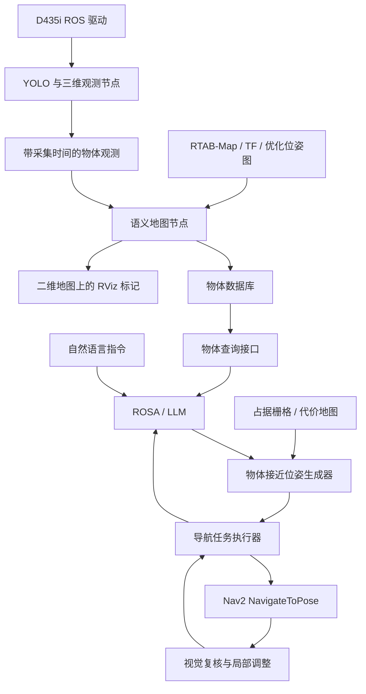

# 基于 YOLO、RTAB-Map、Nav2 与 ROSA 的物体语义导航项目计划书

版本：V1.0  
记录日期：2026-10-27  
项目目录：`/home/y/arm_car/lidar`  
ROSA 目录：`/home/y/arm_car/ROSA/rosa-ros2`  
状态：方案已记录，语义导航各阶段尚待实施和验收。

## 1. 项目目标与完成条件

用户通过 ROSA 对机器人发出自然语言指令，例如：“去最近的一把椅子旁边，停下并让相机正对它。”系统查询物体实例，计算可到达的停车位置和朝向，调用 Nav2 导航，并通过相机复核到达后的观察效果。

最终应具备以下能力：

1. 将 D435i 与 YOLO 得到的物体三维观测转换到 RTAB-Map 的 `map` 坐标系。
2. 对重复观测去重、融合，为同类不同物体分配永久实例编号。
3. 在二维栅格地图上显示物体标签，同时保存可查询、可加载的物体数据库。
4. 根据物体位置、车体尺寸、地图障碍物及相机安装关系，生成停车位置和姿态 goal。
5. 通过 ROSA 的 LLM 理解目标、选择物体和调用导航工具，获取真实执行结果。
6. 到达后判断目标是否可见、是否满足朝向要求，必要时执行有限的局部调整。
7. 在在线建图与回环优化后修正历史物体位置，保证物体数据库与地图一致。

本文中的“全局坐标”指 `map` 坐标系中的米制坐标；它与建图原点绑定，不直接代表地理经纬度。

## 2. 已有基础与当前缺口

| 项目 | 当前已有内容 | 尚需完成的内容 |
|---|---|---|
| 系统 | Ubuntu 22.04、ROS 2 Humble | 核对实施时的包版本、话题与运行配置 |
| 建图与定位 | VLP-16、IMU、ICP 里程计、RTAB-Map 启动配置 | 复测 TF、时间、定位稳定性及重定位流程 |
| 地图 | `maps/rtabmap_nav2_latest.db`、PGM/YAML；现有 YAML 分辨率为 0.05 m | 地图版本管理及语义数据配套保存 |
| Nav2 | 已有导航参数与启动文件 | 实车物体接近任务及到达朝向验收 |
| 相机识别 | `yolov8_d435i/detect_realsense.py`，YOLOv8n ONNX、深度对齐、相机坐标输出 | ROS 消息、采集时间、相机外参、全局坐标和实例融合 |
| ROSA | 本地源码、自定义工具机制、已有短时底盘控制代理 | 语义查询、Nav2 ActionClient、异步导航任务与视觉复核工具 |
| 时钟检查 | `tool/calibration/camera_imu_time_sync.json` 及相关检查工具 | 当前会话统一时间域验证；不能将历史映射当作本次同步证明 |

此前独立程序实测：256×256、ONNX Runtime 两线程时，每帧识别约 23.76 次/秒；每两帧识别时，无窗口处理循环约 34.12 帧/秒、识别约 17.11 次/秒。这些结果只作为独立程序基线，不能视为与 SLAM、Nav2 同机运行时的性能保证。

当前识别只打印相机坐标；当前框中心区域的深度中值是可见表面的代表点，不保证等于物体真实几何中心。现有时间映射文件标记 `measurement_offset_calibrated=false`，并说明设备重启后需重新建立映射。

## 3. 系统架构与职责



- LLM：理解指令、消除歧义、选择真实物体和有效候选方案、解释执行结果。
- 语义地图：维护物体身份、位置、观测质量、时效性和地图版本。
- 位姿生成器：计算停车位置、朝向、可达性和可见性。
- Nav2：负责规划、路径跟踪、避障和位姿导航状态。
- 视觉复核：确认目标在视野中及其画面偏差；局部调整由控制程序执行。

目标位姿必须来自地图和几何计算。LLM 提交工具返回的候选方案编号，由执行器发送对应的已校验位姿，不依赖 LLM 自行编造坐标或四元数。

## 4. 实施顺序与里程碑

第一轮先在固定地图定位模式下完成闭环，第二轮增加在线建图和回环处理。第一轮也要保留原始观测，为第二轮提供数据基础。

| 阶段 | 阶段目标 | 前置依赖 | 里程碑 |
|---|---|---|---|
| P0 | 需求、接口与基线确认 | 无 | M0：参数和验收用例可追溯 |
| P1 | 相机、ROS 时间与 TF 接入 | P0 | M1：每条观测具有有效时间和坐标系 |
| P2 | 物体三维定位与全局坐标验证 | P1、固定地图定位 | M2：机器人运动时固定物体位置保持稳定 |
| P3 | 语义数据库、去重、地图标记与保存 | P2 | M3：物体可查询、可显示、重启后可复用 |
| P4 | 接近位姿、朝向、Nav2 与视觉复核 | P3、Nav2 基础导航通过 | M4：不经过 LLM 可完成物体接近任务 |
| P5 | ROSA 自然语言工具接入 | P4 | M5：第一版自然语言物体导航闭环 |
| P6 | 在线建图和回环后的语义修正 | P3、位姿图接口验证 | M6：回环后历史语义位置随地图更新 |
| P7 | 联合性能、异常回归与交付 | P5、P6 | M7：最终版本可重复部署和验收 |

各阶段实际开始、结束日期随验收记录更新；不以预设工期代替完成条件。

## 5. P0：需求、接口与基线确认

**具体任务**

1. 确认相机是否刚性固定，记录相机高度、平移、安装偏航和俯仰；确认是否具有云台。
2. 确认“正对”的标准：目标可见、水平居中，还是严格位于二维画面中心。
3. 选择第一批少量静态目标，例如椅子、显示器、杯子，确认它们是否属于现有模型类别。
4. 确认同类实例选择规则：最近可达、指定实例、指定房间或由用户选择。
5. 记录运行中的节点、话题、QoS、时间域、TF 发布者、地图和模型版本。现有启动文件部分说明中存在 `icp_odom` 名称，而配置使用 `odom`，实施时以实际 TF 为准并统一文档。
6. 建立固定地图导航基线：先验证定位、普通位置 goal、带朝向 goal、任务取消。
7. 记录车体轮廓、允许停车距离、定位精度要求、视觉居中要求和控制链路。

**交付物**：硬件安装表、接口清单、需求确认表、地图版本清单、基础导航测试记录。

**验收条件**：必须确认的参数有数值或明确的待测方法；基础 Nav2 导航结果真实可复现；未验证项明确标记为待验证。

## 6. P1：相机 ROS 接入、时间与 TF

**具体任务**

1. 使用单一 RealSense 驱动拥有相机设备，输出彩色图、对齐至彩色图的深度、CameraInfo 和内部 TF。改造 YOLO 为订阅节点，避免与独立采集程序争用相机。
2. 核实实际话题与图像编码，不将某一版本驱动的话题名称写死为系统约定。
3. 对彩色图、对齐深度和内参建立时间配对，记录配对时间差；若不能满足配对条件，拒绝生成三维观测。
4. 将设备时间正确映射到统一的 ROS 时间域，保留原始图像采集时间。测量推理和传输延迟，禁止用推理完成时间替代采集时间。
5. 标定、发布 `base_link → camera_link` 的完整六自由度外参，使用驱动提供的光学坐标系转换，避免重复发布同一 TF。
6. 验证 TF 链 `map → odom → base_link → camera_link → camera_color_optical_frame`，并核对变换方向与单位。
7. 建立有限等待和超时丢弃策略；采集时刻的 TF 不可用时，不静默使用最新 TF 替代。
8. 保留相机预览与检测频率独立配置。跳帧预览可复用框，建图观测只使用真正推理的图像及其配对深度。

**交付物**：相机启动配置、外参记录、ROS 识别节点初版、时钟与 TF 检查报告。

**验收条件**：图像、深度、内参与时间能关联；观测携带采集时间和明确的 frame_id；TF 无冲突且可在采集时刻查询；无明显积压。时间残差门限依据运动速度和误差预算确定，不能仅依据消息接收时间宣称硬件同步。

## 7. P2：三维观测与全局位置验证

**具体任务**

1. 使用对齐深度对应的相机模型反投影。通过设备或驱动的实际深度比例转换到米，替换独立脚本固定的 `/1000` 假设。
2. 增加深度有效率、离散程度、量程、边缘截断和遮挡检查；异常观测带原因拒绝或降权。
3. 从框内前景深度聚类开始，保留中心中值作为对照；对薄物体、桌椅等场景评估是否需要实例分割。
4. 发布结构化三维观测，可使用 `vision_msgs` 搭配质量消息，或定义自有消息；接口实现前冻结字段。
5. 按采集时刻计算 `p_map(t) = T_map←base(t) × T_base←camera × p_camera(t)`。
6. 使用固定物体与测量参考点，分别做静止、多距离、多角度、机器人平移和旋转测试。
7. 分开统计绝对定位误差与多次观测重复性；5 cm 栅格分辨率不等于 5 cm 物体定位精度。

**建议观测字段**：observation_id、capture_stamp、source_frame、class_id、class_name、score、bbox、position、位置质量或协方差、有效深度比例、临时 track_id、模型版本。

**交付物**：相机/全局三维观测话题、测试 rosbag、误差统计、深度异常样例集。

**验收条件**：固定物体在机器人运动时不随车明显漂移；左右、前后、旋转方向测试均通过；报告不同距离和物体类别的误差。建议初始参考指标为 1–3 m 范围内融合点绝对误差不超过 0.25 m、重复观测离散程度不超过 0.15 m；这些是待 P0 确认的目标，不是当前已达成结果。

## 8. P3：语义数据库、实例融合与地图显示

**具体任务**

1. 设计 SQLite 数据库，至少包含地图版本、物体实例、原始观测、观测关联四类数据。
2. 采用类别兼容性、空间距离、观测质量和多次确认进行实例关联，避免同一物体重复建点或两把相邻椅子合并。
3. 使用可解释的质量权重融合位置；YOLO 置信度不能直接当作位置测量精度。
4. 为永久实例生成 object_id，临时视频 track_id 仅用于辅助关联。
5. 区分已确认、暂存、过期、待复核和动态物体；人的历史位置不作为永久静态导航目标。
6. 提供按类别、实例和位置范围查询的接口，返回位置、时效性和观测质量。
7. 发布 `MarkerArray`，在 RViz 的 `map` 坐标系显示实例编号、类别、位置及不确定性。
8. 完成地图配套保存与加载：RTAB-Map DB、PGM/YAML、语义数据库、外参与模型版本形成同一地图版本。栅格像素换算使用地图 origin 和 resolution，导出图片时处理行方向差异。
9. 保留原始观测及其时间、里程计关联信息，为 P6 回环重计算提供依据。

**交付物**：数据库 schema、语义地图节点、物体查询接口、RViz 配置、保存/加载工具、数据导出说明。

**验收条件**：同一物体多次经过后保持实例身份；同类相邻物体可区分；重启并在同一地图重定位后标记位置一致；地图版本不匹配时能检测并拒绝错误使用。

## 9. P4：物体接近位姿与 Nav2 执行

**具体任务**

1. 根据物体位置或范围，在允许距离带内采样候选停车点，不直接把物体中心当作底盘 goal。
2. 使用地图、代价地图、车体 footprint 和余量，检查候选点及到达后的车体占地；通过 Nav2 路径规划验证可达性。
3. 评估视线、相机视场、目标高度和遮挡；二维地图不足以判定高度遮挡时，结合深度或三维地图检查。
4. 综合路径长度、停车距离、观察角度和物体不确定性对候选点排序。
5. 结合相机安装旋转和平移计算 goal yaw。相机存在平移偏移时，停车后的相机位置随底盘 yaw 改变，需要联合求解或迭代。
6. 使用 `map` 下的 PoseStamped，通过 Humble 的 `NavigateToPose` Action 发送目标，处理接收、执行、成功、失败和取消状态。
7. 到达后重新识别目标，计算图像偏差；由局部控制程序完成有限微调，控制阶段与 Nav2 明确交接。
8. 若目标高度与固定相机俯仰导致无法满足垂直居中，返回能力限制或选择其他停车距离；需要时再引入云台。
9. 处理目标移动、路线被阻挡、定位失效和候选全部不可达；重新规划有次数与超时上限，并返回明确原因。

**水平朝向关系**：设停车后相机位置为 `(x_c, y_c)`，物体为 `(x_o, y_o)`，相机前向相对车体前向的水平夹角为 α，则 `yaw_base = atan2(y_o-y_c, x_o-x_c) - α`。相机位置使用完整安装外参计算。

**交付物**：候选位姿生成器、路径与可见性评分、Nav2 任务执行器、视觉复核和微调模块、状态接口。

**验收条件**：在不经过 LLM 的情况下，给定 object_id 即可完成“查询→规划→导航→视觉复核”；成功必须同时报告 Nav2 到达状态与视觉检查结果。建议水平朝向误差参考值为 5°，或目标中心水平偏差小于图像宽度 5%，两者的适用条件和最终门限在 P0 确认；无深度、目标丢失等情况不得误报视觉复核成功。

## 10. P5：ROSA 与 LLM 接入

**具体任务**

1. 复用本地 ROSA 自定义工具机制，增加语义导航工具及机器人能力说明，不直接依赖原有短时底盘移动工具实现位姿导航。
2. 将自然语言解析为目标类别、实例约束、接近距离和观察要求；存在多个无法区分的候选时，返回候选供用户选择。
3. 通过工具读取真实物体数据和规划结果。LLM 选择 object_id 与 plan_id，执行器负责校验地图版本、候选时效和真实数值。
4. 将导航任务异步化，返回 task_id；工具调用采用任务去重，避免重复请求触发重复导航。
5. 将成功、不可达、目标过期、导航失败、取消、视觉复核失败等状态返回 ROSA，保证自然语言答复与实际状态一致。
6. 明确 Nav2、视觉微调、人工遥控和原有 ROSA 底盘工具的控制权，避免多个接口同时驱动车辆。
7. 使用既有模型配置开展工具测试；模型选择、服务配置和费用约束在实施前核对，不在计划中预设更换供应商。

**拟定工具接口**

| 工具 | 主要输入 | 主要输出 |
|---|---|---|
| find_objects | 类别/实例描述/区域约束 | 实例列表、位置、质量、最后观测时间、map_id |
| plan_object_approach | object_id、距离与观察要求 | plan_id、候选 PoseStamped、可达性、路径代价、地图版本 |
| execute_navigation | plan_id、请求去重标识 | task_id、目标接收状态 |
| get_navigation_status | task_id | 执行阶段、Nav2 状态、视觉复核结果、失败原因 |
| verify_target_view | object_id | 是否可见、图像偏差、目标关联质量 |
| cancel_navigation | task_id | 取消请求和执行器反馈 |

这些名称为拟议接口，不代表当前 ROSA 已内置这些功能。

**交付物**：ROSA 语义导航适配器、工具 schema、任务状态协议、机器人提示词、对话与执行日志。

**验收条件**：覆盖“去最近椅子”“去指定杯子并看着它”“有多把椅子”“目标不存在”“目标不可达”“取消导航”等指令；无物体数据时不能编造 goal；仅查询或解释指令不触发运动；重复工具请求不创建重复任务。

## 11. P6：在线建图与回环修正

**具体任务**

1. 订阅当前安装版本的 RTAB-Map MapGraph/MapData，核实实际话题、节点编号、采集时间和优化后位姿。
2. 将观测关联到关键帧；图像和关键帧时间不一致时，使用里程计相对运动补偿，不能只采用时间最近关键帧的原始位姿。
3. 保存观测在锚定关键帧坐标系中的位置及相对变换依据。
4. 接收优化后关键帧位姿，重算历史观测的 map 位置，然后重新融合和检查实例关联。
5. 不能只更新当前 map→odom 而保持所有历史物体坐标不变，也不能假定一次统一刚体变换足以修正整段历史轨迹。
6. 回环、图优化或地图切换时更新 map_revision。未执行的旧候选需要重新校验；执行中的任务按变化大小决定重规划或终止。
7. 对关键帧缺失、跨会话合并、重建地图和轨迹重置定义数据处理规则；缺乏锚定依据的观测进入待复核状态。

**交付物**：关键帧观测关联、语义重投影、版本更新机制、回环测试 rosbag 和前后误差对比。

**验收条件**：闭环路线回到同一物体时，不因轨迹优化留下两组明显错开的永久标记；优化后物体与地图保持一致；保存、重载后结果可复现；失效候选不会按旧坐标静默继续执行。

## 12. P7：联合性能、异常回归与交付

**具体任务**

1. 在 SLAM/定位、YOLO、Nav2、ROSA 同机运行时，测量 CPU、内存、图像积压、推理延迟、TF 等待时间和规划响应。
2. 按任务需要调整模型输入尺寸、线程数、相机流与识别频率。静态语义观测可从 5–10 Hz 起步试验，不要求每次推理都写数据库。
3. 使用有界队列和新鲜度检查，记录丢帧与丢观测原因，优先防止积压观测被当作当前物体位置使用。
4. 回归相机断开、深度缺失、定位失效、物体移走、地图版本变化、路径阻挡、LLM 超时、重复请求和任务取消。
5. 建立固定测试集，分别记录物体定位、实例关联、Nav2 到达、视觉复核和自然语言任务成功率。
6. 编写启动、关闭、录包、保存、恢复、参数调整和故障排查文档。

**交付物**：统一启动入口、配置模板、部署说明、数据备份方法、测试集和最终验收报告。

**验收条件**：建议至少进行 10 次覆盖不同目标与起点的完整任务，初始目标为不少于 8 次成功；逐项记录失败原因，单独统计导航成功但视觉复核失败。成功率门限待 P0 确认，不能以少量演示代替回归测试。

## 13. 建议目录与数据组织

以下为实施时的建议结构，本文没有创建对应功能包或接口：

```text
/home/y/arm_car/lidar/
├── docs/语义导航项目计划书.md
├── src/semantic_nav_interfaces/   # 观测、查询、任务状态等接口
├── src/semantic_mapping/          # 三维观测、实例融合、数据库、标记、回环修正
├── src/semantic_navigation/       # 接近位姿、Nav2、视觉复核与任务执行
├── maps/<map_id>/
│   ├── map.yaml / map.pgm
│   ├── rtabmap.db
│   ├── objects.sqlite
│   └── manifest.yaml             # 地图版本、模型、外参、时间与保存状态
└── results/semantic_navigation/   # 每次试验的配置、指标、日志和录包索引

/home/y/arm_car/ROSA/rosa-ros2/
└── src/<semantic_navigation_adapter>/  # ROSA 工具与提示词
```

具体包名和字段在 P0/P1 确认。现有 `maps/rtabmap_nav2_latest.*` 的使用方式应提供兼容或迁移说明，避免后续启动文件加载错误地图。

## 14. 待确认信息

| 编号 | 需要确认的内容 | 影响阶段 | 状态 |
|---|---|---|---|
| Q1 | D435i 固定位置、完整外参、安装高度与俯仰角 | P1、P2、P4 | 已提供雷达到相机的初步平移与下俯50°；待确认frame原点、横滚及标定验证 |
| Q2 | 正对目标的定义及水平/垂直容差，是否使用云台 | P0、P4 | 待确认 |
| Q3 | 首批目标类别、是否区分同类实例、是否需要自定义训练 | P0、P2、P3 | 待确认 |
| Q4 | 第一版停车距离、车体余量、允许导航误差 | P0、P4 | 待确认 |
| Q5 | 物体移动后的更新、过期和重新确认策略 | P3、P4 | 待确认 |
| Q6 | 未见过的目标是否需要主动探索搜索 | P5、后续扩展 | 待确认 |
| Q7 | 当前相机、雷达、里程计时间域与同步验证结果 | P1、P2 | 待实测 |
| Q8 | 固定地图版本、基础 Nav2 实车导航结果 | P0、P2、P4 | 待复测 |
| Q9 | ROSA 实施时使用的模型配置、工具调用与响应要求 | P5、P7 | 待核对现有配置 |

主动探索、开放词汇识别、跨会话外观重识别、云台控制均作为扩展能力，不默认包含在第一版闭环中。

2026-10-30 安装关系更新：按用户指定采用 `velodyne → camera_link` 平移 `[0.096769992, 0.017500000, -0.064108820] m`、四元数 xyzw `[0, 0.4233835445, 0, 0.9059505363]`，等价于 roll=0、pitch≈50.096779735°、yaw=0。语义建图启动配置与局部/整车预览使用同一安装关系，替代2026-10-27的初步参数。此更新表示已采用该配置，不代表完成实物外参标定验收。详见同目录《雷达相机TF初步关系.md》。

## 15. 阶段执行记录模板

每完成一阶段，在独立测试报告中记录，并更新下表。未验收前不标记完成。

| 阶段 | 状态 | 开始日期 | 验收日期 | 配置/代码版本 | 测试报告 | 遗留问题 |
|---|---|---|---|---|---|---|
| P0 | 待开始 | — | — | — | — | 见 Q1–Q9 |
| P1 | 待开始 | — | — | — | — | — |
| P2 | 待开始 | — | — | — | — | — |
| P3 | 待开始 | — | — | — | — | — |
| P4 | 待开始 | — | — | — | — | — |
| P5 | 待开始 | — | — | — | — | — |
| P6 | 待开始 | — | — | — | — | — |
| P7 | 待开始 | — | — | — | — | — |

报告至少包含测试环境、地图版本、外参版本、模型与参数、场景和起点、原始数据位置、实测指标、失败原因及下一步；将建议阈值与实测结果分列。

## 16. 参考接口与现有文件

- [RTAB-Map ROS 2 MapGraph](https://github.com/introlab/rtabmap_ros/blob/ros2/rtabmap_msgs/msg/MapGraph.msg)：优化后的节点编号与位姿。
- [ROS 2 Humble OccupancyGrid](https://github.com/ros2/common_interfaces/blob/humble/nav_msgs/msg/OccupancyGrid.msg)：二维栅格接口；物体语义另外保存。
- [Nav2 Humble NavigateToPose](https://github.com/ros-navigation/navigation2/blob/humble/nav2_msgs/action/NavigateToPose.action)：位置与姿态目标、执行反馈。
- [ROSA 自定义工具](https://github.com/nasa-jpl/rosa/wiki/Custom-Agents)：通过 tools/tool_packages 扩展代理能力。
- 当前识别程序：`/home/y/arm_car/lidar/yolov8_d435i/detect_realsense.py`。
- 当前建图配置：`/home/y/arm_car/lidar/src/velodyne_bringup/launch/lidar3d.launch.py`。
- 当前导航配置：`/home/y/arm_car/lidar/src/velodyne_bringup/config/nav2_params.yaml`。
- 当前 ROSA 底盘代理：`/home/y/arm_car/ROSA/rosa-ros2/src/rosa_chassis/agent.py`。

后续实施以本机安装版本、实际消息和实测结果为准；本计划书不代表已完成上述能力或启动机器人运动。
