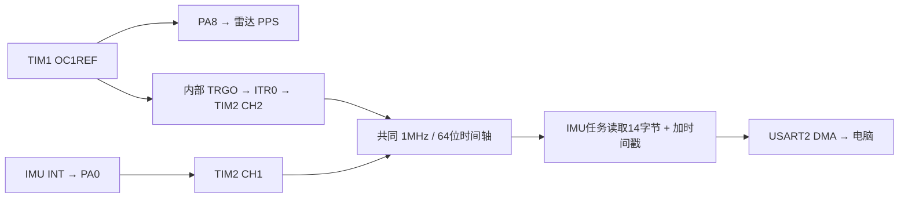

# STM32F103C8：VLP-16 模拟 GPS + 同时基 IMU + FreeRTOS

当前工程位于仓库的 `tools/fake_gps/fake_gps`。在已识别 PPS/GPRMC 的 GPS 固件基础上，参考 `tools/imu_for_slam/imu_for_slam` 的 MPU6050/MPU6500 驱动、软件 I²C、静态 FreeRTOS 和 DMA 串口实现，新增 IMU 硬件捕获时间戳与独立电脑串口。

**目标配置为 200Hz IMU，电脑串口 460800/8N1，雷达串口 9600/8N1、PPS 1Hz/100ms。** 200Hz 是 IMU 内部采样分频的标称值，实际频率受 IMU 自身振荡器及总线负载影响，通过设备计数和电脑实收计数验收，不通过补发重复样本凑频率。

前期完成了 HSE/HSI 两个构建、主机逻辑检查和模拟串口验证。随后在已连接的 STM32 上实收到了符合 v2 协议的 MPU6500 数据，约 200Hz，并同时收到了雷达扫描；接收记录见 `output/reception_validated/summary.json` 和 [接收工具说明](tools/README.md)。**接收测试不等于测得 INT 捕获延迟或跨秒物理同步误差。**

当前构建占用：HSE版本 Flash 22056字节、静态RAM 9556字节；HSI版本 Flash 21960字节。GPIO捕获时间、序号和CRC的主机检查、400帧/200Hz伪串口检查以及独立测试话题的ROS Imu收发均已通过。

## 1. 接线和资源分配

| 功能 | STM32 引脚 | 外设/接线 |
| --- | --- | --- |
| 雷达 PPS | **PA8** | TIM1_CH1 → 雷达 `GPS PULSE`，正脉冲，不反相 |
| 雷达 NMEA | **PA9** | USART1_TX → 74HC04 1A/A1；1Y/B1 → 雷达 `GPS RECEIVE` |
| IMU SCL | **PB10** | 软件 I²C，接模块 SCL |
| IMU SDA | **PB11** | 软件 I²C，接模块 SDA |
| IMU 数据就绪 | **PA0** | TIM2_CH1 输入捕获，接模块 **INT**，上升沿 |
| 电脑串口发送 | **PA2** | USART2_TX → 3.3V USB-UART 的 RXD |
| 电脑串口接收 | **PA3** | USART2_RX ← 3.3V USB-UART 的 TXD，可接收命令 |
| 公共信号地 | **GND** | IMU、USB-UART、74HC04、雷达 `GROUND` 与 STM32 共地 |
| 调试 | PA13 / PA14 | 保留 SWD |
| 状态灯 | PC13 | IMU 在线且 HSE 时慢闪，离线更快；以数据状态为准 |

IMU 和 74HC04 按当前方案使用 3.3V。PB10/PB11 需要上拉至 3.3V，典型 2.2～4.7kΩ；模块已有上拉时先核对现有电路。MPU AD0 接地选地址 0x68，接高选 0x69，驱动自动探测两者；支持 WHO_AM_I=0x68（MPU6050）及 0x70（MPU6500）。

选择依据：PA9 已专用于雷达，不能继续照搬旧 IMU 工程的 USART1；PB10/PB11 已给 IMU，不能再用于 USART3。USART2 的 PA2/PA3 与现有连接无冲突。保留参考工程的软件 I²C，避免 I2C2_TX 与 USART1_TX 同占 DMA1_Channel4。

| 硬件资源 | 当前用途 |
| --- | --- |
| TIM1，APB2 | 10kHz 计数、PWM2 PPS、内部 CH2 在 PPS 后 200ms 通知 GPS 任务 |
| TIM2，APB1 | **1MHz、16位计数器**，中断扩展到64位；CH1 捕获 IMU INT，CH2 捕获内部 PPS |
| TIM4，APB1 | HAL 的 1ms tick，保证 RCC/I²C 等超时独立于 RTOS |
| SysTick | FreeRTOS 1ms 调度时钟 |
| DMA1_Channel4 | USART1 GPS TX |
| DMA1_Channel7 | USART2 电脑 TX |

TIM1_CH2 **没有启用引脚输出**，不会占用 PA9。TIM2_CH2 的输入是内部 TRC，不使用 PA1，也不需要把 PA8 额外跳线到另一个引脚。

74HC04 VCC/GND 旁加 100nF 去耦，未使用输入固定电平。雷达柱端高电平需实测 >3.0V，低电平 <1.2V；3.3V 反相器负载后的电平裕量仍需符合具体雷达和器件规格。

## 2. 同一个时间基准如何实现

TIM1 的 OC1REF 同时驱动 PA8 的 PPS 和内部 TRGO；TIM2 通过 ITR0 将该边沿锁存到 CCR2。IMU INT 则锁存到同一 TIM2 的 CCR1。两次捕获使用同一个 1MHz 计数器，时间不依赖任务何时醒来、I²C 何时读完、电脑何时收到串口。



第一条 PPS 上升沿对应 `include/gps_config.h` 的 `GPS_START_*`，默认 **2026-01-01 00:00:00（模拟 UTC）**。第一条 PPS 在启动计数后约 900ms 出现。此前的 IMU 事件不发送，因为时间映射尚未建立。

IMU 时间计算：

```text
模拟 epoch_us = 首个 PPS 的设定日期时刻 + (IMU捕获计数 - 首个PPS捕获计数)
小时内 hour_us = epoch_us % 3600000000
```

PPS/GPRMC 的先前关系保持不变：上升后 100ms 下降，约 200ms 开始发 GPRMC，报文关联其前面的 PPS。发送窗口为 200～300ms；迟到直接丢弃。联合版本固定要求 `GPS_RMC_SECOND_OFFSET=0`，保证 IMU 和 GPRMC 采用同一个定义。

F103 的 TIM2 只有 16 位，每 65536μs 回绕一次，已做64位扩展，并处理捕获与回绕同时挂起的情况。该算法要求捕获中断最长延迟小于约32ms，当前任务/串口临界区均保持短小；不要在其他新增代码中长时间关中断。64位时间戳避免旧32位微秒计数约71.6分钟回绕的问题。

`g_sync_clock.interval_error_max_us` 可检查内部 PPS 捕获间隔相对 1000000μs 的最大偏差，`valid` 应在首次 PPS 后变为 true。

**INT 标记的是数据就绪，不是无延迟的物理采样瞬间。** MPU 的 DLPF 和内部流水线会有固定/频率相关延迟（当前 DLPF=3）；此实现没有假定或扣除某个统一延迟值。1μs 是时间计数分辨率，不能据此宣称整套雷达—IMU 物理采样同步精度达到1μs。

## 3. IMU 频率和 RTOS

复用参考工程的量程和滤波：

- MPU6050/MPU6500 自动识别，I²C 地址0x68/0x69。
- DLPF=3，陀螺仪输出基频1kHz，SMPLRT_DIV=4，标称200Hz。
- 加速度 ±4g，8192 LSB/g，输出 m/s²，保留重力和原始偏置。
- 角速度 ±2000°/s，16.4 LSB/(°/s)，输出 rad/s。
- 温度按具体型号换算。MPU6500 额外设置加速度 DLPF。
- INT 配成数据就绪、高电平脉冲输出；PA0 捕获其上升沿。

| 任务 | 优先级 | 工作 |
| --- | --- | --- |
| GPS | 4 | 每1ms检查一次定时器事件，格式化并通过 USART1 DMA 发送 GPRMC |
| IMU_DRDY | 3 | 等待捕获事件，读取一次连续14字节，转换 SI 单位，送样本队列 |
| PC_UART | 2 | 独占电脑发送环形缓冲区，DMA发送，处理命令，每秒上报状态 |
| Idle | 0 | FreeRTOS 空闲任务 |

使用静态任务、静态队列，无 FreeRTOS 动态堆。任务堆栈和队列有界，运行时记录最低剩余栈。TIM1/GPS USART IRQ 不调用 RTOS API；TIM2 优先级6，可调用 FromISR API，符合最大系统调用优先级5的限制。HAL TIM4 tick 优先级3，无 RTOS 调用；SysTick/PendSV 为最低优先级。

没有 IMU FIFO：积压后只读取最新寄存器，旧事件计为丢弃，避免把同一份最新数据重复贴上多个旧时间戳。事件太旧、读取期间新一帧到达、I²C失败、队列满等均显式计数。INT 100ms 未出现会进入 IMU 重试状态；**IMU 离线不影响雷达 PPS/GPRMC 继续工作**。STOP 命令仅暂停电脑 IMU 流，采样和 GPS 均继续。

每条 IMU 包72字节，200Hz 为14400B/s；再加每秒一条72字节状态包，8N1 约需144720bit/s，为460800线路约31.4%的负载。一条包占线约1.56ms，低于5ms采样周期。实际还需以 `read_max_us`、丢帧计数、电脑端实收频率验证。

## 4. 串口协议 v2

与 `imu_for_slam` 旧42字节协议不同，旧接收器不能直接解析。所有整数/float均小端；float为 IEEE754 binary32。

```text
A5 5A | version=02 | type | payload_length=40 00 | 64字节payload | CRC16_L CRC16_H
```

CRC16/CCITT-FALSE：初值0xFFFF、多项式0x1021，覆盖帧偏移2～69（version至payload末字节），不包含A5 5A及CRC本身。总长72字节。

### type=1：IMU 数据 payload

| payload偏移 | 类型 | 含义 |
| --- | --- | --- |
| 0 | uint32 | INT事件序号 sequence |
| 4 | uint64 | 捕获时的单片机单调时间 monotonic_us |
| 12 | uint64 | 同GPS基准的模拟 Unix epoch_us |
| 20 | uint32 | hour_us，与雷达小时内微秒计数同一表示 |
| 24 | uint32 | 该时刻对应的PPS序号，首PPS为1 |
| 28 | float×3 | ax/ay/az，m/s² |
| 40 | float×3 | gx/gy/gz，rad/s |
| 52 | float | 温度，℃ |
| 56 | uint32 | flags |
| 60 | uint32 | 固件累计 lost_samples |

flags：bit0=时间映射有效，bit1=INT硬件捕获，bit2=HSE运行，bit3=MPU6500，bit4=与上个已读取样本存在序号间隔，bit5=IMU在线，bit6=串口流开启。

### type=2：状态 payload

连续16个uint32，依次为：

```text
uptime_ms, sysclk_hz, flags, who_am_i,
drdy_count, imu_reads, samples_queued, lost_samples,
imu_io_errors, sample_queue_drops, tx_drops, read_max_us,
read_rate_millihz, send_rate_millihz, pps_count, nmea_sent
```

频率数值除以1000得到Hz。`samples_queued` 及 `send_rate_millihz` 指送入串口发送缓冲区，不是电脑确认收到的数量；电脑工具独立统计实收频率/丢序号/CRC错误。STATUS 中 bit1/bit4不使用，其余标志定义一致。

命令为ASCII行：`@PING\r\n`、`@STATS\r\n`、`@STOP\r\n`、`@START\r\n`。收到命令立即返回一条状态帧。未实现旧版TEXT/HEX切换，以固定二进制协议保证带宽可控；未知命令也返回状态，不修改采样或授时。

## 5. 编译、烧录和电脑接收

在本目录：

```bash
pio run -e genericSTM32F103C8 -e genericSTM32F103C8_hsi
pio run -e genericSTM32F103C8 -t upload
```

默认 HSE 8MHz×9=72MHz；HSE超时后回退HSI/2×16=64MHz。强制HSI版本为 `genericSTM32F103C8_hsi`，仅用于启动/连通性诊断。保留CMSIS启动文件，显式回到HSI再配置PLL；不把 `board_build.f_cpu` 当成实际RCC设置。**HAL使用TIM4，不能再给SysTick_Handler加HAL_IncTick，也不能让FreeRTOS和HAL各自定义一个SysTick。**

产物：`.pio/build/genericSTM32F103C8/firmware.bin` 和 `firmware.elf`。已保留修改前GPS-only固件：`firmware_backup/gps_only_hse.bin`、`gps_only_hsi.bin`；旧版说明在 `docs/gps_only_reference.md`。备份不包含本次IMU功能。

电脑端使用已具备 pyserial 的 Python 环境，例如本机 `/usr/bin/python3`：

```bash
/usr/bin/python3 tools/imu_receive.py --list-ports
/usr/bin/python3 tools/imu_receive.py --port /dev/ttyUSB0 --duration 10 --csv imu.csv
/usr/bin/python3 tools/imu_receive.py --port /dev/ttyUSB0 --command STATS
```

设备名需按实际 USB-UART 确定。PA2→适配器RX、PA3←适配器TX、GND共地，460800/8N1，3.3V逻辑。工具每秒显示接收频率、CRC、序号间隔、最近六轴数据及设备状态。遇到坏帧/截断会重新搜索帧头。串口数据本身使用捕获时间戳，不会用电脑接收时间覆盖。

### 可选 ROS 2 输出

```bash
source /opt/ros/humble/setup.bash
/usr/bin/python3 tools/imu_receive.py --port /dev/ttyUSB0 --ros --topic /imu/stm32_raw
```

默认 `--ros-time lidar`：用包内 `hour_us`，按当前电脑邻近小时补齐日期/小时，与现有 Velodyne 驱动的时间表示策略一致；不会把串口接收延迟直接作为IMU时间。若雷达也改成从GPRMC恢复完整日期，才应同时选择 `--ros-time epoch`。

ROS消息单位为m/s²、rad/s，frame默认 `imu_link`。原始六轴无姿态解算，orientation_covariance[0]=-1，其他协方差0代表尚未提供估计。默认发布独立话题，未更改现有底盘驱动、SLAM IMU话题或TF外参；接入建图前需显式选用它并确认IMU安装外参，避免与底盘 `/imu_raw` 混流。

同一设备只打开一个接收程序。脚本不启动电机，不自动烧录或修改电脑时钟。

### IMU 与雷达同时接收并画图

新增 `tools/imu_lidar_scope.py`，通过串口接收 IMU、通过现有 `/velodyne_packets` 接收雷达扫描，实时绘制接收成功/失败冲激，并保存 CSV、统计和接收时间/设备时间两种图片。当前雷达驱动已经占用 UDP 2368，默认订阅 ROS 话题即可。完整运行命令与坐标定义见 [tools/README.md](tools/README.md)。

## 6. 验证

主机回归：

```bash
/usr/bin/python3 tests/run_checks.py
/usr/bin/python3 tests/test_sync_protocol.py
/usr/bin/python3 tests/run_driver_checks.py
/usr/bin/python3 tests/test_serial_pipeline.py
```

覆盖GPS日期/校验和/窗口，RTOS与UART中断向量，64位时间与16位捕获溢出，首PPS/跨小时/跨天，IMU连续14字节/失败不提交/SI换算/两种型号配置，协议CRC/分片/坏帧恢复，以及200Hz模拟串口→真实接收程序→CSV的400帧完整性。模拟串口检查不代表真实IMU频率已达标。

烧录并连接硬件后，验收顺序：

1. 雷达Web保持激光On、PPS Locked，GPRMC逐秒更新；示波器检查PA8的1Hz/100ms及PA9的9600/8N1。
2. 未接IMU时电脑仍应收到每秒状态，who_am_i/online/错误计数应能说明离线，GPS继续正常。
3. 接入PB10/PB11/PA0，WHO_AM_I应为0x68或0x70，INT约5ms一次。若有I²C ID但无数据，检查INT及PA0，查看`drdy_timeouts`。
4. 连续接收至少60秒，实收频率约200Hz，CRC错误和队列/发送丢弃应为0；记录`read_max_us`，必须有余量低于5ms。频率小幅偏离200可来自IMU振荡器，持续缺帧需结合计数定位。
5. 同时记录雷达原始时间计数和IMU hour_us，验证PPS前后、跨分钟/跨小时连续性和整秒关联，确认没有固定1秒偏差。再验证动态TF和IMU去畸变，不只看PPS Locked。
6. 查看`g_app`的任务栈余量、读取超时/竞争/捕获溢出；`g_sync_clock.interval_error_max_us`应接近0～1μs量级（需实测）。任一异常先定位，再增加采样率或接入建图。

调试断点会冻结计时器，外部IMU仍可能继续采样，因此连续授时和频率验收时应脱离断点运行。

INT时间仍包含传感器内部滤波延迟；没有外部真实UTC参考时，整套STM32/雷达时基仍会随晶振漂移。两路使用同一时基解决相对时间表示，不能替代轴向、外参、零偏和传感器延迟标定。

## 7. 源码与依据

- `src/board.c`：时钟、引脚、DMA、PPS和UART回调分发；`src/capture_time.c`：1MHz硬件捕获、回绕扩展。
- `src/app_rtos.c`：三个静态任务、队列、漏帧策略和诊断；`src/hal_timebase.c`：独立HAL tick。
- `src/mpu6050.c`、`soft_i2c.c`、`imu_units.c`：由当前 `imu_for_slam` 对应驱动复制并调整；采样时间改由INT捕获提供。
- `src/imu_protocol.c`、`serial_hal.c`：v2协议和USART2 DMA发送；`tools/imu_receive.py`：电脑接收、CSV和可选ROS。
- [ST RM0008](https://www.st.com/resource/en/reference_manual/rm0008-stm32f101xx-stm32f102xx-stm32f103xx-stm32f105xx-and-stm32f107xx-advanced-armbased-32bit-mcus-stmicroelectronics.pdf)：TIM2 ITR0→TIM1、TRC输入捕获、16位计数及DMA映射。
- [TDK MPU6050 Register Map](https://invensense.tdk.com/wp-content/uploads/2015/02/MPU-6000-Register-Map1.pdf)：采样分频、DLPF和数据就绪中断。
- [FreeRTOS Cortex-M3/M4 端口说明](https://wap.freertos.org/Documentation/02-Kernel/03-Supported-devices/04-Demos/ARM-Cortex/RTOS-Cortex-M3-M4)：中断优先级及FromISR约束。
- [VLP-16厂商手册](https://data.ouster.io/downloads/velodyne/user-manual/vlp-16-user-manual-revf.pdf)：PPS/NMEA接口；[公开同步研究及作者实现](https://github.com/MobileRoboticsSkoltech/lidar-sync-mimics-gps)：参考MCU模拟GNSS统一时基的架构。

这是新联合固件的工程实现，尚未获得工业认证或复现论文的精度结果，硬件验收记录应独立保存。
